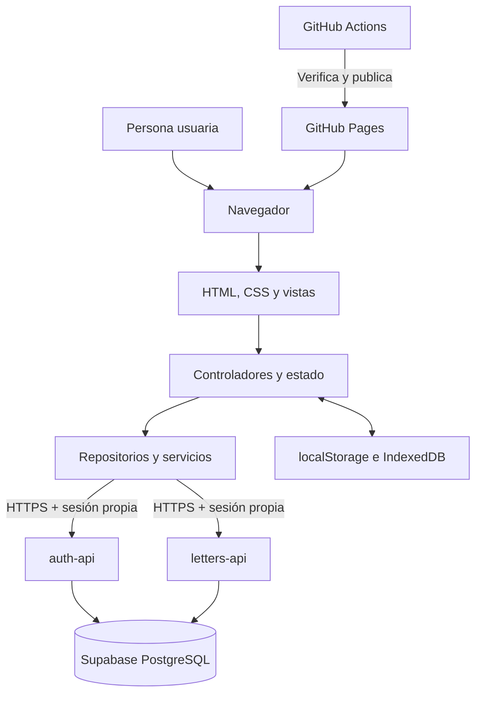

<div align="center">
  
  <h1>Nuestro Rincón</h1>
  <p><strong>Un espacio privado para escribir, compartir y conservar cartas entre dos personas.</strong></p>
  <p>
    <a href="https://github.com/DeividD11/Nuestro-rincon/actions/workflows/pages.yml"></a>
    
    
    
    <a href="LICENSE"></a>
  </p>
  <p>
    <a href="https://deividd11.github.io/Nuestro-rincon/">Abrir aplicación</a>
    ·
    <a href="https://github.com/DeividD11/Nuestro-rincon">Repositorio</a>
    ·
    <a href="docs/SECURITY.md">Modelo de seguridad</a>
    ·
    <a href="docs/ACCESSIBILITY.md">Accesibilidad</a>
  </p>
</div>

---

## 1. Visión general

**Nuestro Rincón** es una aplicación web de correspondencia privada concebida para dos personas. Permite redactar cartas, guardarlas como borradores, enviarlas, recibir respuestas, organizar la correspondencia y conservarla en un espacio personal.

El proyecto combina una interfaz estática —publicable directamente en **GitHub Pages**— con un backend gestionado en **Supabase**. La aplicación no necesita un servidor Node.js, PHP ni otro proceso web permanente para funcionar en producción.

Su arquitectura mantiene separados los modelos, las vistas, los controladores, los repositorios y los servicios. Las operaciones privadas se realizan en Supabase Edge Functions; el navegador no recibe credenciales privilegiadas ni decide por sí mismo la identidad con la que se ejecuta una operación.

> [!IMPORTANT]
> **Estado remoto comprobado y actualizado el 24 de noviembre de 2026:** proyecto `tiqbmuubpbmxqvtkcdhq` activo; `auth-api` v11 y `letters-api` v11 en estado ACTIVE. La v11 conserva los exports ESM nombrados `sendNotification` y `setVapidDetails` de `web-push@4.0.0`, y añade diagnóstico seguro de errores de Storage sin registrar contenido privado. El ledger remoto contiene 25 migraciones. El inventario local v35 contiene 28 archivos SQL: 17 timestamps coinciden con el ledger, tres archivos son legacy/no canónicos y ocho propuestas locales siguen sin una entrada homónima que deba reconciliarse. La columna `public.user_profiles.avatar_path` ya existe en producción. La migración `20261123205422_revoke_other_app_sessions_atomically.sql` se aplicó y verificó: crea un RPC `SECURITY INVOKER`, ejecutable solo por `service_role`, y el índice de `push_subscriptions.session_id`. El bucket privado `private-media` está creado y verificado en el ledger mediante `20261124052017_ensure_private_media_bucket.sql`: privado, límite de 5 MiB y MIME JPEG/PNG/WebP. Los logs confirman una URL firmada, una carga PUT y la verificación HEAD con HTTP 200; la función de perfil también confirmó la escritura de la ruta del avatar. No ejecutes ninguna de las ocho propuestas locales sin un diff completo ni uses este ZIP como restauración integral de una base nueva. Consulta [`docs/REMOTE_BASELINE.md`](docs/REMOTE_BASELINE.md), [`docs/MEDIA_AND_AVATARS.md`](docs/MEDIA_AND_AVATARS.md) y [`docs/SYNC_RELEASE_RUNBOOK.md`](docs/SYNC_RELEASE_RUNBOOK.md).

<details>
  <summary><strong>Contenido de esta documentación</strong></summary>

  - [Visión general](#1-visión-general)
  - [Funcionalidades](#2-funcionalidades)
  - [Tecnologías](#3-tecnologías)
  - [Arquitectura](#4-arquitectura)
  - [Estructura del repositorio](#5-estructura-del-repositorio)
  - [Requisitos de desarrollo](#6-requisitos-de-desarrollo)
  - [Configuración del frontend](#7-configuración-del-frontend)
  - [Ejecución local](#8-ejecución-local)
  - [Despliegue en GitHub Pages](#9-despliegue-en-github-pages)
  - [Backend Supabase](#10-backend-supabase)
  - [Seguridad, privacidad y límites](#11-seguridad-privacidad-y-límites-conocidos)
  - [Calidad y pruebas](#12-calidad-y-pruebas)
  - [Solución de problemas](#13-solución-de-problemas)
  - [Documentación adicional](#14-documentación-adicional)
  - [Licencia](#15-licencia)

</details>

## 2. Funcionalidades

### Correspondencia

- Redacción de cartas con título y contenido enriquecido.
- Guardado de borradores y autoguardado local/remoto.
- Envío de cartas y respuestas dentro de conversaciones.
- Navegación entre cartas y respuestas del mismo hilo sin recargar la aplicación ni volver a solicitar cada carta ya cargada.
- Hasta seis imágenes por carta o respuesta; se redimensionan y rasterizan en el navegador antes de subirlas y se muestran con límites responsive.
- Miniaturas privadas optimizadas para `letter-stamp` (96 × 96, calidad 72 cuando Storage Image Transformations está disponible), con carga diferida, decodificación asíncrona, placeholder animado y fallback automático al original.
- Bandejas de entrada y enviados.
- Organización mediante Borradores, Favoritos, Archivo y Papelera.
- Recuperación de cartas descartadas y eliminación definitiva conforme a las reglas compartidas.
- Descarga de cartas en texto o HTML e impresión desde el navegador.
- Estados de entrega y lectura cuando la información está disponible.
- Paginación progresiva de carpetas, notificaciones e hilos, con orden estable por fecha e ID y búsqueda textual en PostgreSQL para las cartas aún no cifradas.

### Borradores y continuidad

- Copia de emergencia local durante la escritura.
- Persistencia complementaria en IndexedDB.
- Sincronización remota agrupada para reducir peticiones por cada pulsación.
- Cola serializada para evitar escrituras simultáneas sobre la misma revisión.
- Detección de conflictos cuando el contenido remoto y el local han cambiado de forma distinta.
- Recuperación de copias pendientes al volver a abrir la aplicación o recuperar la conexión.
- Protección para que un guardado automático atrasado no restaure por accidente un borrador que ya está en Papelera.
- Un borrador nuevo solo se crea cuando el cuerpo contiene texto real; entrar al editor o completar solamente el título no crea registros vacíos.

La copia local permite recuperar el texto aunque la última petición de red no alcance el servidor. El navegador no puede garantizar que una solicitud pendiente se complete al cerrar la pestaña; por eso la recuperación local no depende de la última escritura remota.

### Cuentas y sesiones

- Registro con nombre de usuario y contraseña, sin correo obligatorio.
- Invitaciones privadas de 256 bits, de un solo uso y con caducidad de siete días.
- La primera cuenta activa puede generar, copiar y revocar la invitación para la segunda persona.
- Los intentos de invitación se limitan por IP anonimizada y huella del código; el backend registra auditoría sin guardar el código ni la IP en claro.
- Límite de dos cuentas activas; el registro no admite altas sin una invitación válida.
- Inicio y cierre de sesión.
- Gestión, revocación individual y revocación masiva de todas las demás sesiones sin cerrar la sesión actual.
- Avatar de perfil desde una imagen local, con optimización, cambio y eliminación.
- Renovación de sesión y control de expiración.
- Cambio de nombre visible, nombre de usuario, correo informativo y contraseña.
- Recuperación de contraseña con un código de respaldo individual de un solo uso durante el registro, compatible con la versión `auth-api` v11 actualmente desplegada.
- Registro idempotente: si se pierde la respuesta después de crear la cuenta, el mismo intento puede reanudarse con los mismos datos y la contraseña original sin consumir otra invitación; los reintentos también quedan sujetos al límite de intentos.
- El código individual se genera antes de enviar el registro y se conserva temporalmente en `localStorage` junto con el identificador idempotente (nunca se guarda la contraseña). PostgreSQL conserva únicamente su hash. Si el resultado del servidor es incierto, la interfaz lo marca como pendiente y no afirma que esté activo hasta confirmar la operación.
- El backend local incluye una implementación ampliada de paquetes de diez códigos; su activación en producción requiere desplegar de forma coordinada la Edge Function y las migraciones compatibles. No se presupone activa en `auth-api` v11.
- Registro con verificación transaccional de la invitación y límites de intentos por IP anonimizada y huella del código.
- Eliminación de cuenta con verificación de contraseña y confirmación explícita.

**El correo es informativo:** no se utiliza para iniciar sesión ni para recuperar la cuenta y la aplicación no envía correos transaccionales.

### Experiencia de usuario

- Diseño adaptable para móvil, tableta y escritorio.
- Tema claro, oscuro y automático según el sistema.
- Navegación lateral adaptable.
- Estados de carga, error, vacío y confirmación.
- Diálogos accesibles para acciones importantes y avisos emergentes descartables.
- Modales con fondo inmóvil, bloqueo del desplazamiento de la página y desplazamiento contenido en la tarjeta.
- La vista de Borradores muestra inmediatamente la copia local al salir del editor, sin esperar la sincronización remota.
- Preferencias persistidas por cuenta.
- Respeto por `prefers-reduced-motion` y áreas seguras de dispositivos móviles.

## 3. Tecnologías

| Capa | Tecnología | Responsabilidad |
|---|---|---|
| Interfaz | HTML5 | Estructura semántica de la aplicación |
| Estilos | CSS moderno | Sistema visual, temas y diseño responsive |
| Lógica cliente | JavaScript ES Modules | Estado, interacción y navegación |
| Hosting | GitHub Pages | Publicación del frontend estático |
| API privada | Supabase Edge Functions | Autenticación propia y operaciones de dominio |
| Persistencia | Supabase PostgreSQL | Cuentas, sesiones, cartas, preferencias, notificaciones y suscripciones Web Push |
| Archivos privados | Supabase Storage | Imágenes de cartas y avatares en bucket privado con URL firmada y caducidad |
| Seguridad de datos | PostgreSQL RLS y funciones SQL | Restricción de acceso y reglas transaccionales |
| Persistencia local | localStorage e IndexedDB | Copias de emergencia y recuperación de borradores |
| Procesamiento de imágenes | Canvas / ImageBitmap | Redimensionamiento, rasterización y eliminación de metadatos antes de subir |
| Automatización | GitHub Actions | Verificación, pruebas y despliegue continuo |
| Pruebas | Node.js Test Runner | Pruebas de contrato, seguridad, fiabilidad y responsive |

No se utiliza un framework frontend. La aplicación desplegada sigue siendo estática y no necesita dependencias npm en producción. Para la auditoría automatizada se fijan `@playwright/test` y `axe-core` en `package-lock.json`; instala el árbol reproducible con `npm ci` antes de ejecutar Playwright/axe.

## 4. Arquitectura



### Separación de responsabilidades

| Módulo | Ubicación | Función |
|---|---|---|
| Modelos | `assets/js/models/` | Estado y estructuras de la aplicación |
| Vistas | `assets/js/views/` | Renderizado de interfaz y formularios |
| Controladores | `assets/js/controllers/` | Orquestación de acciones y navegación |
| Repositorios | `assets/js/repositories/` | Acceso a operaciones del dominio |
| Servicios | `assets/js/services/` | API, sesiones, almacenamiento local y persistencia/sincronización de borradores |
| Utilidades | `assets/js/utils/` | Sanitización, diálogos, avisos y formato |
| Backend compartido | `supabase/functions/_shared/` | Validación de sesión, CORS y utilidades de servidor |
| Controlador principal | `assets/js/controllers/app-controller.js` | Construcción de estado compartido y composición de módulos (aprox. 80 líneas) |
| Inicialización | `assets/js/controllers/app-initialization-controller.js` | Arranque secuencial, tema inicial y restauración de sesión |
| Coordinación de eventos | `assets/js/controllers/app-event-coordinator-controller.js` | Listeners globales, accesibilidad responsive y delegación de eventos |
| Ciclo de sesión | `assets/js/controllers/session-lifecycle-controller.js` | Restauración, revocación entre pestañas y aislamiento del estado privado |
| Handlers de eventos | `assets/js/controllers/app-submit-handler.js`, `app-click-handler.js` | Procesan formularios y acciones con el contexto de la instancia principal |
| Fachada de vistas | `assets/js/views/app-view.js` | Mantiene el contrato público de renderizado y delega el contenido por sección |
| Vistas por sección | `auth-view.js`, `correspondence-view.js`, `settings-view.js` | Renderizado de autenticación, correspondencia y configuración |
| Controlador de autenticación | `assets/js/controllers/auth-controller.js` | Recuperación, continuidad de registro y cierre forzado de sesión |
| Controlador de navegación | `assets/js/controllers/navigation-controller.js` | Rutas, caché, paginación y carga progresiva |
| Controlador de cartas | `assets/js/controllers/letter-controller.js` | Lectura, respuesta, envío, formato y descarga |
| Controlador de borradores | `assets/js/controllers/draft-controller.js` | Edición, cola y coordinación del autoguardado |
| Persistencia de borradores | `assets/js/services/draft-persistence-service.js` | Copias de emergencia, recuperación e hidratación de borradores locales |
| Controlador de configuración | `assets/js/controllers/settings-controller.js` | Preferencias, sesiones, tema y validación de sesión |
| Controlador de notificaciones | `assets/js/controllers/notification-controller.js` | Bandeja y actualización periódica de notificaciones |
| Cola de sincronización | `assets/js/services/draft-sync-queue.js` | Serialización de escrituras de borradores por cuenta |
| Poller adaptativo | `assets/js/services/adaptive-poller.js` | Actualización por actividad, visibilidad y backoff |
| Funciones | `supabase/functions/` | Endpoints privados de autenticación y correspondencia |
| Migraciones | `supabase/migrations/` | Evolución del esquema y reglas SQL disponibles en el paquete |

### Flujo de una operación privada

1. La interfaz solicita una acción mediante el repositorio correspondiente.
2. El servicio API envía la solicitud a la Edge Function e incluye la sesión propia.
3. La Edge Function valida el token y recupera la identidad asociada a esa sesión.
4. El backend verifica permisos y reglas del dominio antes de operar sobre PostgreSQL.
5. La respuesta vuelve al repositorio y el controlador actualiza el estado y la vista.

El backend no confía en un `user_id` enviado por el navegador como prueba de identidad.

## 5. Estructura del repositorio

```text
nuestro-rincon/
├── .github/
│   └── workflows/
│       ├── pages.yml             # Calidad continua, cobertura y despliegue de Pages
│       └── security-*.yml        # Pruebas aisladas de DB, integración y UI
├── assets/
│   ├── css/
│   │   ├── app.css               # Tokens, layout y base visual
│   │   ├── app-components.css    # Componentes y secciones compartidas
│   │   ├── app-auth.css          # Autenticación y recuperación
│   │   ├── editor.css            # Editor y pie del editor
│   │   └── accessibility.css     # Foco visible y ajustes de accesibilidad
│   ├── icons/
│   └── js/
│       ├── config/               # Configuración pública del cliente
│       ├── controllers/          # Coordinador y handlers/controladores especializados
│       ├── models/               # Estado y modelos
│       ├── repositories/         # Operaciones de dominio
│       ├── services/             # API, sesiones y persistencia local
│       ├── utils/                # Diálogos, avisos y funciones comunes
│       ├── views/                # Fachada y vistas de autenticación/correspondencia/configuración
│       ├── app.js
│       └── theme-boot.js
├── docs/
│   ├── ACCESSIBILITY.md          # Navegación por teclado, foco, contraste y lectores de pantalla
│   ├── CI_RELEASE_POLICY.md      # Política de verificación antes de publicar
│   ├── GITHUB_BRANCH_PROTECTION.md # Ruleset recomendado para main
│   ├── LETTER_SEARCH_PERFORMANCE.md # Medición EXPLAIN y candidatos pg_trgm
│   ├── PAGINATION.md             # Cursores keyset y búsqueda
│   ├── PUSH_NOTIFICATIONS_ROADMAP.md # Estado y operación de Web Push
│   ├── CONTROLLER_ARCHITECTURE.md  # Módulos de vistas/controladores y actualización adaptativa
│   ├── REMOTE_BASELINE.md        # Estado conocido del Supabase existente
│   └── SECURITY.md               # Límites de confianza y controles
├── scripts/
│   ├── build-pages.mjs           # Generador de _site/
│   └── package-zip.mjs           # Crea el ZIP fuente sin .git ni artefactos locales
├── supabase/
│   ├── functions/                # Edge Functions
│   ├── migrations/               # Migraciones incluidas
│   ├── schema/                   # Referencia del esquema
│   └── config.toml
├── tests/                        # Pruebas automatizadas
├── tools/                        # Verificación estática del proyecto
├── 404.html
├── index.html
├── .nojekyll
├── .gitignore
├── LICENSE
├── .nvmrc
├── package.json
├── package-lock.json
└── README.md
```

`assets/` es la única fuente de estilos, módulos e iconos; `index.html` y `404.html` son las únicas entradas HTML. La carpeta `public/` obsoleta se retiró. `_site/` se genera automáticamente durante la compilación y no forma parte de la distribución del código fuente.

## 6. Requisitos de desarrollo

- Node.js 24 o una versión compatible con los módulos ES y el test runner de Node.
- npm, incluido con Node.js.
- Un navegador moderno.
- Acceso al proyecto Supabase correspondiente para probar las operaciones remotas.

El runtime de la aplicación no carga dependencias npm en producción. Las dependencias de desarrollo para navegador y accesibilidad están fijadas en `package-lock.json`.

## 7. Configuración del frontend

La configuración pública del cliente se encuentra en:

```text
assets/js/config/app-config.js
```

El archivo define:

- Nombre de la aplicación.
- URL pública del proyecto Supabase.
- Clave `publishable` del proyecto.
- Nombres de las Edge Functions.
- Claves locales de almacenamiento.
- Idioma y zona horaria predeterminados.

La clave `sb_publishable_...` está diseñada para estar en el cliente. **No es una clave privilegiada.** Nunca coloques `service_role`, `sb_secret_...`, `SUPABASE_SECRET_KEYS`, contraseñas ni tokens privados dentro de `assets/`, HTML, CSS, JavaScript o GitHub Pages.

GitHub Pages sirve archivos estáticos y no interpreta archivos `.env`. Para apuntar a otro proyecto Supabase, modifica `app-config.js` y revisa la configuración de las Edge Functions y el esquema de ese proyecto.

## 8. Ejecución local

Clona el repositorio y entra en su directorio:

```bash
git clone https://github.com/DeividD11/Nuestro-rincon.git
cd Nuestro-rincon
```

Ejecuta las verificaciones:

```bash
npm ci
npm run check
npm run check:contrast
npm test
```

Genera el sitio estático:

```bash
npm run build:pages
npm run package:zip
```

`npm run package:zip` genera `dist/nuestro-rincon-source.zip`. El empaquetador excluye `.git/`, dependencias instaladas, salida `_site/`, cobertura, informes de pruebas, archivos temporales, archivos `.env` y ZIP anteriores; incluye el código fuente, documentación, pruebas y workflows. Puedes indicar otra ruta con `npm run package:zip -- --output /ruta/al/paquete.zip`.

Sirve la salida generada desde `_site/` con un servidor estático. Por ejemplo:

```bash
python -m http.server 8000 --directory _site
```

En Windows también puedes usar `py -m http.server 8000 --directory _site`. Abre `http://localhost:8000/` en el navegador. El servidor local solo sirve archivos; no sustituye las Edge Functions ni PostgreSQL.

## 9. Despliegue en GitHub Pages

El repositorio incluye un workflow que verifica el proyecto, ejecuta la suite automatizada, genera `_site/`, sube el artefacto y publica el sitio.

### Configuración inicial

1. Abre **Settings → Pages** en el repositorio.
2. En **Build and deployment**, selecciona **GitHub Actions** como fuente.
3. Comprueba que GitHub Actions tenga permiso para publicar Pages.
4. Envía los cambios a `main` o inicia manualmente el workflow desde la pestaña **Actions**.

### Pipeline

El workflow `.github/workflows/pages.yml` separa verificación y despliegue. `.nvmrc` fija Node.js 24.22.3, `package.json` declara npm 11.19.1 y `package-lock.json` fija las dependencias de desarrollo; las acciones externas usan SHA completos verificados (con su etiqueta de versión en comentario) y Dependabot propone sus actualizaciones:

**Job `verify`** (en `pull_request`, `push` a `main` y ejecución manual):

1. Checkout del repositorio.
2. Preparación de Node.js 24 y Deno 2.9.8 (versión fijada).
3. `npm ci` instala el árbol exacto desde el lockfile.
4. `npm run check` y `npm run check:contrast` verifican estructura y 24 combinaciones de contraste de la paleta.
5. `npm run check:edge` ejecuta `deno check` sobre `core.ts`, `auth-api` y `letters-api` con Deno 2.9.8.
6. `npm test` ejecuta pruebas unitarias/contrato; `npm run test:coverage` calcula cobertura real de `assets/js`, aplica mínimos iniciales de 25 % de líneas, 35 % de funciones y 55 % de ramas, y genera `coverage/lcov.info`.
7. `npm run build:pages` y `npm run test:a11y` (axe-core/WCAG 2.2 A/AA en Chromium).
8. Sube el informe LCOV como artefacto de diagnóstico y, si el evento es un `push` a `main` o una ejecución manual sobre `main`, genera el artefacto oficial `github-pages` directamente desde `_site/` mediante `actions/upload-pages-artifact`.

**Job `deploy`** (solo para `main`, después de `verify`): depende de `verify` mediante `needs: verify` y ejecuta `actions/deploy-pages` sobre el artefacto `github-pages` ya publicado. No vuelve a descargar ni a empaquetar el sitio. La separación entre jobs evita consultar los metadatos de un artefacto en el mismo instante en que acaba de subirse. Una pull request nunca despliega el sitio. La protección de rama no se activa desde el código: sigue [`docs/GITHUB_BRANCH_PROTECTION.md`](docs/GITHUB_BRANCH_PROTECTION.md) para exigir el check `Verify frontend and Edge Functions` y bloquear force-push/eliminación de `main`.

Si falla una verificación o una prueba, el job `deploy` no se ejecuta.

**URL del sitio:** https://deividd11.github.io/Nuestro-rincon/

## 10. Backend Supabase

El backend utiliza dos Edge Functions:

| Función | Responsabilidad |
|---|---|
| `auth-api` | Registro, inicio de sesión, renovación, revocación, recuperación y gestión de cuentas |
| `letters-api` | Cartas, respuestas, borradores, carpetas, preferencias, sesiones, límites por cuenta y suscripciones/entrega Web Push |

Las funciones están configuradas en `supabase/config.toml` con `verify_jwt = false` porque el producto no utiliza Supabase Auth. La autenticación de la aplicación se realiza mediante tokens opacos propios, que las Edge Functions validan consultando sus hashes y vencimientos en PostgreSQL.

Supabase inyecta la credencial de servidor en el runtime de Edge Functions. El código del proyecto no necesita exponerla ni copiarla a la configuración del navegador. Consulta [`docs/SECURITY.md`](docs/SECURITY.md) para el modelo de confianza y los controles.

### Estado del proyecto existente

La inspección remota más reciente se realizó el **24 de noviembre de 2026** en el proyecto `tiqbmuubpbmxqvtkcdhq`. El estado actual, historial de migraciones y límites de reconciliación se detallan en [`docs/REMOTE_BASELINE.md`](docs/REMOTE_BASELINE.md).

- PostgreSQL 17 y proyecto `ACTIVE_HEALTHY`.
- `auth-api` v11 y `letters-api` v11 en estado `ACTIVE`.
- 25 migraciones registradas en el ledger remoto.
- `public.user_profiles.avatar_path` y su restricción de propietario/formato existen en producción.
- El bucket `private-media` quedó registrado por `20261124052017_ensure_private_media_bucket`: privado, límite de 5 MiB y MIME JPEG/PNG/WebP.
- Los logs de Storage confirman URL firmada POST 200, carga PUT 200 y comprobación HEAD 200; la escritura de la ruta del avatar también respondió 200. La prueba de inserción/lectura de imágenes dentro de una carta entre las dos cuentas sigue pendiente de validación manual.
- La migración `20261123205422_revoke_other_app_sessions_atomically.sql` se aplicó en producción. Su RPC revoca sesiones, refresh tokens y push subscriptions de forma atómica, excluyendo la sesión actual.
- El inventario local v35 contiene 28 archivos SQL: 17 timestamps coinciden con el ledger, tres ficheros legacy/no canónicos y ocho propuestas anteriores sin entrada homónima. Ocho timestamps remotos todavía no tienen archivo local homónimo.

Por tanto:

- No ejecutes `supabase db push --remote` ni apliques ninguna de las ocho propuestas anteriores sin un diff completo. Compara primero las definiciones y permisos exactos; puede hacer falta reconciliar el ledger sin volver a ejecutar DDL existente.
- No despliegues `auth-api` desde este ZIP; permanece en v11 y no forma parte de este cambio.
- La configuración del bucket quedó aplicada y registrada. La primera prueba de uso de la interfaz debe confirmar que el avatar persiste al recargar y que las imágenes de carta se leen correctamente desde la otra cuenta.
- No uses este paquete como restauración completa de una base Supabase vacía.

El estado de referencia y las limitaciones se documentan en [`docs/REMOTE_BASELINE.md`](docs/REMOTE_BASELINE.md).

## 11. Seguridad, privacidad y límites conocidos

> **E2EE todavía no está implementado.** Las cartas y borradores pueden permanecer en texto legible en PostgreSQL y en el almacenamiento local del navegador. `docs/E2EE_ARCHITECTURE.md` es una propuesta de diseño, no una garantía de cifrado activo. No almacenes información especialmente sensible bajo la expectativa de que el servidor no pueda leerla.

### Controles implementados

- Autenticación propia; no se utiliza Supabase Auth.
- Contraseñas derivadas con PBKDF2-HMAC-SHA256 mediante Web Crypto, 600.000 iteraciones y sal aleatoria individual.
- Tokens de sesión aleatorios; se almacena el hash del token de acceso.
- Refresh tokens rotatorios y detección de reutilización.
- Validación de sesión e identidad en el backend.
- Limitación de intentos de acceso y recuperación.
- Diez códigos de respaldo aleatorios por cuenta; PostgreSQL solo almacena hashes y consumir uno invalida el conjunto restante. La rotación exige contraseña actual y sesión activa.
- RLS y restricciones de permisos para las tablas y RPC privadas.
- Validación de pertenencia a cartas e hilos.
- Sanitización del HTML de las cartas con listas permitidas.
- Respuestas API con encabezados de protección y políticas de no almacenamiento.

### Limitaciones que deben conocerse

- La aplicación admite dos cuentas activas. El registro exige una invitación privada válida; no se puede completar solo con la URL pública. La primera cuenta activa genera desde Configuración un código aleatorio de 256 bits, de un solo uso y válido durante siete días. PostgreSQL conserva únicamente su hash; el código se muestra una sola vez.
- El código de invitación se muestra una sola vez y debe compartirse por un canal privado. Si se pierde antes de utilizarse, revoca esa invitación pendiente y genera otra. Esto no reemplaza al código personal de recuperación, que sirve para restablecer la contraseña de una cuenta ya creada.
- En una instalación Supabase vacía, la primera invitación de bootstrap se genera manualmente desde el SQL Editor; ese procedimiento solo está autorizado para el rol PostgreSQL `postgres` y se describe en [`docs/INVITATIONS.md`](docs/INVITATIONS.md).
- No hay CAPTCHA, segundo factor ni recuperación por correo.
- Si se pierden todos los códigos de respaldo y la sesión ya no está activa, no hay recuperación por correo. No se debe intentar restablecer la cuenta mediante una operación administrativa improvisada.
- Web Push tiene service worker, consentimiento por dispositivo y envío genérico preparado para cartas y respuestas; no se activa hasta aplicar la migración nueva, desplegar `auth-api` y `letters-api` compatibles y configurar VAPID. La entrega no está garantizada. La actualización en tiempo real dentro de la web sigue usando sondeo adaptativo; Realtime privado queda pendiente del puente JWT descrito en `docs/REALTIME_AUTH_BRIDGE.md`.
- El contenido de las cartas se procesa en texto legible en las Edge Functions y PostgreSQL. **No existe cifrado de extremo a extremo.** La arquitectura propuesta y sus riesgos están documentados en [`docs/E2EE_ARCHITECTURE.md`](docs/E2EE_ARCHITECTURE.md); no se afirma que el cifrado esté implementado.
- `sessionStorage` mantiene el refresh token en el origen de la aplicación y `localStorage` conserva temporalmente el código de recuperación pendiente, sin guardar la contraseña. Un XSS persistente podría comprometer una sesión o leer un código pendiente; la sanitización y la CSP forman parte de las defensas, pero no sustituyen una auditoría de seguridad.
- No se declara una auditoría de penetración ni una evaluación dinámica exhaustiva de IDOR/XSS.

Lee [`docs/SECURITY.md`](docs/SECURITY.md) y [`docs/INVITATIONS.md`](docs/INVITATIONS.md) antes de operar el registro. No publiques códigos de invitación, recuperación, tokens ni credenciales de servidor.

## 12. Calidad y pruebas

Los comandos principales son:

| Comando | Resultado |
|---|---|
| `npm run check` | Verifica archivos requeridos, sintaxis de módulos, imports, recursos locales, configuración y workflow |
| `npm run test:edge-unit` | Comprueba la lectura incremental del cuerpo, media types, JSON mal formado, límite de bytes y mapeo de errores en Deno |
| `npm run check:edge` | Ejecuta `deno check` con configuración independiente de `auth-api` y `letters-api` (incluye sus imports compartidos) antes del despliegue |
| `npm run check:contrast` | Audita 24 combinaciones de color de la paleta clara y oscura |
| `npm run test:a11y` | Ejecuta axe-core en Chromium para nueve vistas y ambos temas, incluidos errores, recuperación, Papelera y confirmación destructiva; requiere `npm ci` y Chromium |
| `npm test` | Ejecuta las pruebas de contrato, seguridad, fiabilidad, sesiones, diseño responsive, búsqueda literal y configuración CI |
| `npm run test:coverage` | Repite la suite con cobertura real de `assets/js`, aplica mínimos de líneas/funciones/ramas y genera `coverage/lcov.info` |
| `npm run build:pages` | Genera el sitio estático en `_site/` |
| `npm run package:zip` | Crea el ZIP fuente sin `.git/`, `.env`, dependencias, build ni resultados locales |
| `npm run test:integration` | Ejecuta escenarios HTTP reales de dos cuentas, sesiones, concurrencia, idempotencia y límites; requiere Supabase aislado |
| `npm run test:db` | Ejecuta siete archivos pgTAP: rate limits de autenticación, purga compartida, renombrado transaccional, paquete de recuperación, paginación cursor, límites API/Web Push y semántica de búsqueda; bloquea producción |

Los siete archivos ejecutados por el runner son: `auth_rate_limits.test.sql`, `shared_letter_purge.test.sql`, `profile_rename_transaction.test.sql`, `recovery_code_bundles.test.sql`, `cursor_pagination.test.sql`, `api_rate_limits_and_push.test.sql` y `search_semantics.test.sql`.
| `npm run test:e2e` | Ejecuta pruebas Playwright en escritorio y móvil; requiere cuentas de prueba |

La distribución actual incorpora pruebas automatizadas de contratos, recuperación idempotente, aislamiento y regresiones del código. La auditoría axe-core se ejecuta en GitHub Actions para nueve vistas y dos temas, con fixtures adicionales de errores de formularios, códigos de respaldo, diálogo destructivo y estados de Papelera. Todavía requiere pruebas manuales con NVDA, VoiceOver y TalkBack; consulta `docs/ACCESSIBILITY.md` y no declares conformidad hasta registrar esas pruebas. La suite no sustituye pruebas de integración con el backend remoto ni una inspección visual en dispositivos físicos. Antes de una publicación importante, valida al menos el registro, acceso, creación y sincronización de borradores, envío, respuesta, recuperación, Papelera, cierre de sesión y cambio de dispositivo.

## 13. Solución de problemas

| Síntoma | Comprobación recomendada |
|---|---|
| GitHub Pages no publica | Revisa **Settings → Pages**, que la fuente sea **GitHub Actions**, los permisos `pages: write` e `id-token: write` del job `deploy` y el último registro de **Actions**. El job `verify` debe subir `github-pages` con `actions/upload-pages-artifact`; `deploy` debe depender de `verify`. Si el artefacto aparece en la lista del run pero `deploy-pages` no puede leer sus metadatos, vuelve a ejecutar el job `deploy` una vez que la carga haya terminado y revisa el estado de GitHub. |
| La verificación falla por `public/` | Elimina la copia antigua. La fuente web es la raíz del repositorio y `assets/`; `_site/` se genera al compilar. |
| No se conecta a Supabase | Comprueba URL y clave `publishable` en `app-config.js`, el estado de las funciones y la consola del navegador. |
| No se puede guardar un borrador | No cierres ni descartes la copia local. Comprueba la conexión, vuelve a sincronizar y revisa si la interfaz muestra un conflicto de revisión. |
| La segunda persona no aparece como destinataria | La cuenta debe haberse registrado. Los borradores provisionales no se comparten ni se envían automáticamente. |
| Se perdió el acceso | Utiliza el código de recuperación personal, si se conservó. No existe recuperación por correo. |

## 14. Documentación adicional

- [`docs/ACCESSIBILITY.md`](docs/ACCESSIBILITY.md): navegación por teclado, gestión del foco, regiones de anuncios, auditoría axe-core, paleta de contraste y matriz manual con lectores de pantalla. Las comprobaciones con NVDA, VoiceOver y TalkBack siguen pendientes de ejecución manual.
- [`docs/CI_RELEASE_POLICY.md`](docs/CI_RELEASE_POLICY.md): verificaciones automáticas y pasos aislados obligatorios antes de publicar cambios de backend.
- [`docs/PAGINATION.md`](docs/PAGINATION.md): cursor keyset para carpetas, hilos y notificaciones.
- [`docs/LETTER_SEARCH_PERFORMANCE.md`](docs/LETTER_SEARCH_PERFORMANCE.md): estado de búsqueda, EXPLAIN, pg_trgm candidato y benchmark en branch aislada.
- [`docs/GITHUB_BRANCH_PROTECTION.md`](docs/GITHUB_BRANCH_PROTECTION.md): ruleset recomendado para proteger `main` (requiere activación manual en GitHub).
- [`docs/PUSH_NOTIFICATIONS_ROADMAP.md`](docs/PUSH_NOTIFICATIONS_ROADMAP.md): estado de Web Push, secretos VAPID, consentimiento, payload genérico y revocación.
- [`docs/REALTIME_AUTH_BRIDGE.md`](docs/REALTIME_AUTH_BRIDGE.md): por qué no se habilitan canales públicos con la sesión opaca actual y qué falta para usar Realtime privado.
- [`docs/SECURITY.md`](docs/SECURITY.md): límites de confianza, sesiones, autenticación y controles de privacidad.
- [`docs/REMOTE_BASELINE.md`](docs/REMOTE_BASELINE.md): estado remoto conocido, migraciones y funciones desplegadas.
- [`docs/LETTERS_CONSISTENCY.md`](docs/LETTERS_CONSISTENCY.md): semántica de carpetas, deduplicación, navegación rápida entre respuestas, borradores no vacíos, consistencia visual y eliminación compartida.
- [`docs/E2EE_ARCHITECTURE.md`](docs/E2EE_ARCHITECTURE.md): diseño, límites, recuperación de claves y migración futura del cifrado de extremo a extremo.
- [`docs/SYNC_RELEASE_RUNBOOK.md`](docs/SYNC_RELEASE_RUNBOOK.md): sincronización segura de código, historial Git, migraciones y Edge Functions.
- [`docs/BACKUP_RESTORE.md`](docs/BACKUP_RESTORE.md): procedimiento de copias cifradas y restauración de prueba; requiere configurar un bucket y credenciales externas.
- [`docs/ACCOUNT_RECOVERY.md`](docs/ACCOUNT_RECOVERY.md): compatibilidad del código de recuperación, bóveda local cifrada y estado de publicación del paquete de códigos.
- [`supabase/schema/README.md`](supabase/schema/README.md): referencia del esquema disponible.

## 15. Licencia

El código se publica para consulta con **Todos los derechos reservados**. La visibilidad pública del repositorio no concede una licencia para reutilizar, modificar o redistribuir el proyecto. Consulta [`LICENSE`](LICENSE) y solicita autorización expresa al titular para cualquier uso no permitido.

---

<div align="center">
  <sub>Hecho para conservar palabras importantes en un espacio privado.</sub>
</div>


## Pruebas de seguridad y entornos aislados

El paquete incorpora tres niveles de pruebas:

- `npm test`: pruebas unitarias, de contrato y regresión del frontend y del código compartido.
- `npm run test:db`: ejecuta los archivos pgTAP con `psql` contra una branch/proyecto aislado; requiere `NR_TEST_CONFIRM_ISOLATED=YES`, `NR_DB_TEST_PROJECT_REF` y `NR_TEST_DATABASE_URL`. Comprueba el plan y el resultado TAP, acepta conexión directa o Session Pooler y bloquea producción.
- `npm run test:integration`: pruebas HTTP reales de dos cuentas contra un proyecto Supabase aislado. Estas pruebas consumen invitaciones, crean cartas y eliminan la cuenta B al validar la preservación de cartas compartidas; **no deben ejecutarse contra producción ni contra una base con datos reales**. Requieren la nueva migración y ambas Edge Functions actualizadas en ese entorno aislado.
- `npm run test:e2e`: pruebas Playwright en Chromium de escritorio y móvil. Requieren dos cuentas de pruebas existentes y variables `NR_E2E_*`.

La migración `20261119064344_auth_attempt_rate_limits.sql` y la actualización de `auth-api` que la usa son una propuesta pendiente de validar en un proyecto/branch aislado. No desplegar esa versión de `auth-api` antes de aplicar y probar la migración en el mismo entorno.

Consulta [`docs/SECURITY_TESTING.md`](docs/SECURITY_TESTING.md) para preparar los escenarios sin tocar producción y [`docs/DB_REBUILD.md`](docs/DB_REBUILD.md) para entender la diferencia entre el historial remoto y los archivos SQL incluidos.


## Imágenes privadas y avatar

La implementación local v36 permite adjuntar hasta seis imágenes por carta/respuesta, muestra la primera como miniatura en `letter-stamp` y permite elegir, cambiar o quitar un avatar. La fuente local de `letters-api` añade la generación de URL firmada para esa primera miniatura; la función remota continúa en v11 hasta que se publique este cambio. El bucket `private-media` se encuentra creado y registrado por la migración `20261124052017_ensure_private_media_bucket.sql`; es privado, limita los objetos a 5 MiB y permite `image/jpeg`, `image/png` y `image/webp`. Los logs de Supabase anteriores confirman carga firmada y verificación de un objeto de avatar con HTTP 200. La columna `user_profiles.avatar_path` ya existía en producción; no se reejecutó la migración local histórica que la declara. La lectura de imágenes de carta desde ambas cuentas sigue requiriendo validación manual. Consulta [`docs/MEDIA_AND_AVATARS.md`](docs/MEDIA_AND_AVATARS.md).

### Ajustes de Configuración v35

La corrección de sesiones incluida en v34 evita los ciclos de petición por sesión: `sessions:revoke-others` llama una vez al RPC `revoke_other_app_sessions`, que bloquea y revoca las demás sesiones, invalida sus refresh tokens y elimina sus suscripciones push en una transacción. La UI actualiza `session-list` de forma optimista, conserva el desplazamiento y no vuelve a renderizar toda la vista. El botón se deshabilita durante la operación y se restaura la lista si el servidor rechaza la acción.

La subida de avatares e imágenes usa `letters-api` v11, que reconoce `media:prepare-upload`, `media:sign-letter-image`, `profile:avatar:set` y `profile:avatar:remove`; el error anterior “Acción no reconocida” se debía a que producción todavía ejecutaba v8 y no al JPEG de 55 KB. `profile-avatar-preview` muestra la imagen local antes de subir y conserva la anterior si falla la operación. El botón `tool-btn image-tool-btn` se rediseñó con icono SVG, etiqueta visible, foco accesible y adaptación a tema oscuro/tamaños pequeños.
El avatar persistido también se representa dentro del `span.avatar` de la barra lateral y se actualiza al confirmar el cambio. El encabezado de página deja de mostrar el marco de foco rosado. El botón de revocación masiva solo se renderiza cuando existe otra sesión activa además de la actual. En teléfonos pequeños, `tool-btn image-tool-btn` se convierte en un control cuadrado de 44 px con icono y nombre accesible, sin texto desbordado. Guardar borrador dirige a Borradores cuando se confirma una copia local o remota; desde una tarjeta de Borradores, Revisar y enviar abre directamente `modal-card`, mientras que Seguir escribiendo mantiene la ruta del editor.

### Optimización de imágenes y miniaturas v36

La vista de `profile-avatar-preview` utiliza un placeholder con brillo suave durante la carga de la foto y no muestra el texto alternativo como contenido provisional. Las imágenes se solicitan con prioridad alta para esa vista y, si un recurso falla, se conserva el fallback de iniciales. El procesador limita las exportaciones de prueba a unas pocas iteraciones adaptativas en lugar de probar decenas de combinaciones secuenciales. Los avatares se optimizan hasta 512 px / 512 KiB; las imágenes de carta hasta 1.600 px / 3 MiB. La subida privada sigue siendo una única petición PUT con URL temporal.

La lista de correspondencia y el inicio reciben `firstImageUrl` para la primera imagen insertada en el HTML de cada carta. `letters-api` comprueba que la ruta corresponde a la carta o su hilo y al remitente antes de firmarla; como máximo se firma una miniatura por carta y se limita el trabajo concurrente a seis cartas. La vista valida el origen de Supabase y muestra el icono del sello si la miniatura falla. Las demás imágenes siguen dentro del cuerpo de la carta y no se sustituyen por miniaturas adicionales.

**Publicación pendiente:** el ZIP incluye el cambio local de `supabase/functions/letters-api/index.ts`, pero no se ha desplegado ni modificado el proyecto remoto durante esta entrega. Para que `letter-stamp` muestre imágenes en producción, primero debe publicarse la nueva fuente de `letters-api` y después el frontend v36 en GitHub Pages. No se requiere migración SQL ni cambio de bucket.


### Correcciones de lectura y miniaturas v37 (24 de noviembre de 2026)

El papel de lectura ahora usa una jerarquía tipográfica consistente, una medida de línea limitada, espaciado de párrafos y listas, y reglas específicas para escritorio, móviles y la vista previa de envío. El contenido largo puede crecer sin quedar recortado por la hoja. Las imágenes del editor conservan su posición y muestran un placeholder animado durante la decodificación; el texto alternativo ya no utiliza el nombre local del archivo. Se aplica el mismo texto genérico al sanitizar en cliente y servidor, incluidas cartas y borradores ya guardados.

Para los sellos, `letter-stamp` mantiene su fallback hasta que carga la primera miniatura privada firmada. La fuente local de `letters-api` incluida en v36/v37 genera `firstImageUrl` únicamente después de validar la relación entre objeto, carta/hilo y remitente. **La publicación de esta función sigue siendo necesaria**: según la última comprobación disponible, el proyecto remoto conserva `letters-api` v11. No se desplegó ninguna Edge Function ni se modificó el esquema remoto durante v37. No requiere migración SQL ni hacer público `private-media`.


### Búsqueda reactiva y estados de imagen v38 (24 de noviembre de 2026)

Los buscadores de Buzón, Enviadas, Borradores, Favoritos, Archivo y Papelera ejecutan consultas en vivo con una pausa breve de 170 ms, pero ya no vuelven a renderizar la aplicación completa. Solo se sustituye `letter-list-results`, manteniendo el control de búsqueda, el foco, el encabezado y el scroll. Cada petición tiene un ID de secuencia para descartar respuestas antiguas que lleguen fuera de orden. El término es temporal: no se guarda en el navegador ni se conserva al cambiar de apartado; el campo desactiva autocompletado y autocorrección.

Al abrir una carta, una imagen que todavía no tenga una URL firmada conserva el placeholder `Cargando imagen…` en lugar de mostrar prematuramente `Imagen no disponible`. El error solo aparece después de un fallo real de carga. En las tarjetas, `letter-stamp` sigue mostrando la primera imagen insertada mediante `firstImageUrl`; la Edge Function local ya contiene esa firma privada y valida la carta/hilo y el remitente. La publicación remota de `letters-api` sigue pendiente según el último estado comprobado (v11); sin ella, el frontend no puede obtener las URL privadas y conserva el sello de respaldo.

Esta entrega no añade migraciones SQL, no cambia el bucket y no modifica el proyecto remoto.

### Miniaturas fiables en Borradores y carga inmediata v39 (24 de noviembre de 2026)

Las tarjetas ya no dependen exclusivamente de que el listado incluya `firstImageUrl`. Si ese campo no llega (por ejemplo, porque la Edge Function remota aún no incorpora el enriquecimiento de lista), el frontend localiza la primera ruta `data-image-path` en el cuerpo del borrador y solicita una URL temporal mediante `media:sign-letter-image`. El servidor sigue validando sesión, ID de carta y ruta privada; el navegador solo acepta URLs HTTPS del proyecto Supabase y del bucket `private-media`. Las firmas se agrupan con un máximo de seis solicitudes concurrentes y se reutilizan temporalmente. Así, `letter-stamp` puede mostrar la miniatura en Borradores con el endpoint de firma ya disponible en `letters-api` v11, sin hacer público Storage ni requerir una nueva migración SQL.

Al elegir una imagen desde el editor, el marco `Cargando imagen…` se inserta inmediatamente, antes de compresión, generación de URL de subida y transferencia. El placeholder es temporal y el sanitizador lo excluye del HTML persistido; tras completar la subida se sustituye por el `` real, que mantiene el estado animado hasta su decodificación. Si la carga falla, se retira el placeholder y se conserva el texto de la carta.

Esta actualización no despliega Edge Functions ni modifica el proyecto remoto o el esquema SQL. `firstImageUrl` sigue siendo una optimización opcional para las listas; el fallback del frontend funciona con el endpoint autenticado `media:sign-letter-image` ya presente en la versión remota v11 verificada anteriormente.


### Miniaturas rápidas y estado de carga del sello v40 (24 de noviembre de 2026)

`letter-stamp-fallback` conserva el espacio y muestra un brillo animado y un indicador de carga, con el mismo patrón visual que `avatar-preview-placeholder`. El indicador permanece mientras la miniatura se descarga y decodifica; si la carga falla se conserva un estado neutral. Las animaciones respetan `prefers-reduced-motion`.

Las tarjetas solicitan una imagen privada transformada de 96 × 96 px, con recorte `cover` y calidad 72, en vez del archivo original completo. Las imágenes se cargan de forma diferida (`loading=lazy`), con decodificación asíncrona y prioridad baja; la carta conserva su imagen original y calidad completa. Si Image Transformations no está habilitado o la URL transformada falla, el frontend solicita la URL firmada original, mantiene el placeholder durante el cambio y evita dejar un sello roto.

La fuente local de `letters-api` incorpora `media:sign-letter-thumbnail`, que comprueba la sesión, la participación del usuario, la carta/respuesta y la ruta privada antes de emitir la URL. **Publicación pendiente:** desplegar la nueva `letters-api` y después el frontend v40 en GitHub Pages. No se agregó una migración SQL ni se hizo público el bucket. Image Transformations depende del plan y de su activación en Storage; si no está disponible, la funcionalidad continúa con el original, aunque sin la reducción de transferencia. Revisa Storage → Settings / Usage para conocer la disponibilidad y el consumo del proyecto.


### Optimización global de imágenes y caché de avatar v41 (24 de noviembre de 2026)

La barra lateral usa ahora el mismo indicador circular y brillo del avatar de Configuración. Los nodos de ambas imágenes se conservan entre cambios de ruta; al volver a Configuración no se crea otra etiqueta `` ni se vuelve a solicitar/decodificar la foto si la identidad del avatar sigue siendo la misma. La vista de Configuración consulta `AvatarNodeCache` correctamente y no genera una imagen de reemplazo antes de restaurar el nodo existente. Al cambiar la foto, la vista previa local permanece en pantalla mientras se precarga y decodifica la URL privada nueva.

`letters-api` genera URL de avatar transformadas a 256 × 256 y calidad 78, y URL de lectura de adjuntos a 1.440 × 1.440 y calidad 78. Los objetos originales del bucket privado no se alteran. Si Storage Image Transformations no está disponible, los endpoints recurren a la URL firmada original. La Edge Function mantiene una caché LRU acotada de URL firmadas por ruta y variante, hasta 2.048 entradas y con vencimiento antes de la expiración del token; además deduplica firmas idénticas simultáneas para evitar llamadas repetidas dentro de la misma instancia. El navegador mantiene los nodos de avatar y las miniaturas cercanas a pantalla se firman en lotes de cuatro.

El sello elimina el panel de fondo cuadrado durante la carga y deja únicamente el indicador circular sobre un fondo transparente. El contenido de `letter-body` utiliza un fondo sólido y normaliza el color de texto, `-webkit-text-fill-color`, opacidad, filtros y sombras para evitar variaciones visuales entre bloques y al final de una carta.

**Publicación pendiente:** v41 incorpora cambios de `letters-api` además del frontend. No se desplegó Supabase ni se cambió el esquema o el bucket en esta entrega. Para usar las transformaciones y la caché nuevas, publicar `letters-api` v41 y después el frontend v41. No requiere migración SQL. Si las transformaciones de Storage no están habilitadas en el proyecto, la aplicación conserva el acceso privado usando el original; la reducción de transferencia dependerá de que Storage permita las variantes transformadas.

### Corrección de centrado del indicador del sello v42 (24 de noviembre de 2026)

El spinner de `letter-stamp-fallback` utiliza ahora una animación independiente que conserva `translate(-50%, -50%)` tanto al inicio como al final de cada giro. Antes, la animación genérica solo interpolaba `rotate(360deg)`, sobrescribía la traslación de centrado y hacía que el círculo viajara diagonalmente antes de volver a su posición. La nueva animación mantiene el centro fijo, conserva el giro uniforme y desactiva el movimiento respetando `prefers-reduced-motion`. No cambia las solicitudes de imágenes, el backend, Storage ni el esquema de datos; basta con publicar el frontend v42 en GitHub Pages.

### Limpieza del placeholder de avatar en la barra lateral v43 (24 de noviembre de 2026)

Mientras el avatar de la barra lateral está cargando, las iniciales del usuario ya no se dibujan detrás del indicador circular. El texto del placeholder se vuelve transparente y se anula su tamaño tipográfico únicamente durante `.is-loading`; si la carga falla y se retira ese estado, las iniciales vuelven a quedar disponibles como fallback. El spinner se amplía ligeramente a 16 px, gana contraste en temas claro y oscuro y permanece centrado mediante márgenes simétricos, por encima del brillo de carga. No cambia la URL, el caché, la compresión, el backend, Storage ni el esquema de datos. Basta con publicar el frontend v43 en GitHub Pages.


### Fiabilidad del avatar lateral v44 (24 de noviembre de 2026)

El avatar de `user-mini` ahora distingue entre reutilizar una imagen válida y reconstruir un nodo que perdió su ``. Cuando el estado contiene una URL pero el nodo cacheado solo conserva las iniciales, el render crea una imagen nueva y no vuelve a sustituirla por el nodo antiguo. Al restaurar una imagen ya descargada se comprueba `complete`/`naturalWidth` y se espera su decodificación; así no queda oculta por un `is-loading` cuyo evento `load` ocurrió antes de volver a insertarla. Si una URL privada falla, la app solicita una firma nueva una sola vez por ruta del avatar. El indicador circular usa la misma animación con traslación centrada de `letter-stamp-fallback`, sin deriva diagonal.

Es una corrección de frontend y gestión de nodos: no cambia la base de datos, el bucket ni las Edge Functions.
