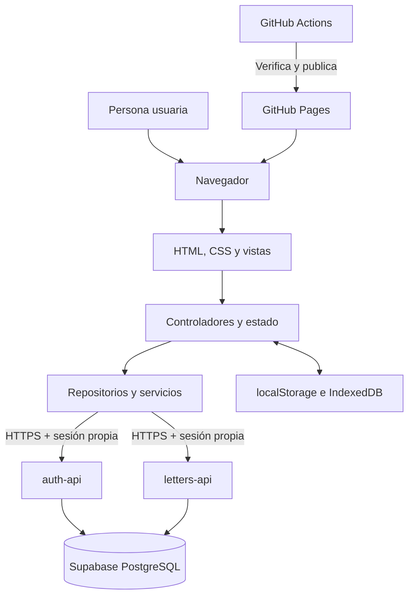

<div align="center">
  
  <h1>Nuestro Rincón</h1>
  <p><strong>Un espacio privado para escribir, compartir y conservar cartas entre dos personas.</strong></p>
  <p>
    <a href="https://github.com/DeividD11/Nuestro-rincon/actions/workflows/pages.yml"></a>
    
    
    
    <a href="LICENSE"></a>
  </p>
  <p>
    <a href="https://deividd11.github.io/Nuestro-rincon/">Abrir aplicación</a>
    ·
    <a href="https://github.com/DeividD11/Nuestro-rincon">Repositorio</a>
    ·
    <a href="docs/SECURITY.md">Modelo de seguridad</a>
  </p>
</div>

---

## 1. Visión general

**Nuestro Rincón** es una aplicación web de correspondencia privada concebida para dos personas. Permite redactar cartas, guardarlas como borradores, enviarlas, recibir respuestas, organizar la correspondencia y conservarla en un espacio personal.

El proyecto combina una interfaz estática —publicable directamente en **GitHub Pages**— con un backend gestionado en **Supabase**. La aplicación no necesita un servidor Node.js, PHP ni otro proceso web permanente para funcionar en producción.

Su arquitectura mantiene separados los modelos, las vistas, los controladores, los repositorios y los servicios. Las operaciones privadas se realizan en Supabase Edge Functions; el navegador no recibe credenciales privilegiadas ni decide por sí mismo la identidad con la que se ejecuta una operación.

> [!IMPORTANT]
> La versión incluida está preparada para continuar trabajando con el proyecto Supabase existente. El historial remoto consultado registra 20 migraciones aplicadas y las funciones `auth-api` y `letters-api` en versión 8. El ZIP contiene 15 archivos de migración; **no es una restauración integral de una base de datos nueva**. Consulta [`docs/REMOTE_BASELINE.md`](docs/REMOTE_BASELINE.md) antes de modificar o reconstruir el backend.

<details>
  <summary><strong>Contenido de esta documentación</strong></summary>

  - [Visión general](#1-visión-general)
  - [Funcionalidades](#2-funcionalidades)
  - [Tecnologías](#3-tecnologías)
  - [Arquitectura](#4-arquitectura)
  - [Estructura del repositorio](#5-estructura-del-repositorio)
  - [Requisitos de desarrollo](#6-requisitos-de-desarrollo)
  - [Configuración del frontend](#7-configuración-del-frontend)
  - [Ejecución local](#8-ejecución-local)
  - [Despliegue en GitHub Pages](#9-despliegue-en-github-pages)
  - [Backend Supabase](#10-backend-supabase)
  - [Seguridad, privacidad y límites](#11-seguridad-privacidad-y-límites-conocidos)
  - [Calidad y pruebas](#12-calidad-y-pruebas)
  - [Solución de problemas](#13-solución-de-problemas)
  - [Documentación adicional](#14-documentación-adicional)
  - [Licencia](#15-licencia)

</details>

## 2. Funcionalidades

### Correspondencia

- Redacción de cartas con título y contenido enriquecido.
- Guardado de borradores y autoguardado local/remoto.
- Envío de cartas y respuestas dentro de conversaciones.
- Bandejas de entrada y enviados.
- Organización mediante Borradores, Favoritos, Archivo y Papelera.
- Recuperación de cartas descartadas y eliminación definitiva conforme a las reglas compartidas.
- Descarga de cartas en texto o HTML e impresión desde el navegador.
- Estados de entrega y lectura cuando la información está disponible.

### Borradores y continuidad

- Copia de emergencia local durante la escritura.
- Persistencia complementaria en IndexedDB.
- Sincronización remota agrupada para reducir peticiones por cada pulsación.
- Cola serializada para evitar escrituras simultáneas sobre la misma revisión.
- Detección de conflictos cuando el contenido remoto y el local han cambiado de forma distinta.
- Recuperación de copias pendientes al volver a abrir la aplicación o recuperar la conexión.
- Protección para que un guardado automático atrasado no restaure por accidente un borrador que ya está en Papelera.

La copia local permite recuperar el texto aunque la última petición de red no alcance el servidor. El navegador no puede garantizar que una solicitud pendiente se complete al cerrar la pestaña; por eso la recuperación local no depende de la última escritura remota.

### Cuentas y sesiones

- Registro con nombre de usuario y contraseña, sin correo obligatorio.
- Límite de dos cuentas activas.
- Inicio y cierre de sesión.
- Gestión y revocación de sesiones/dispositivos.
- Renovación de sesión y control de expiración.
- Cambio de nombre visible, nombre de usuario, correo informativo y contraseña.
- Recuperación de contraseña mediante un código personal de un solo uso.
- Eliminación de cuenta con verificación de contraseña y confirmación explícita.

**El correo es informativo:** no se utiliza para iniciar sesión ni para recuperar la cuenta y la aplicación no envía correos transaccionales.

### Experiencia de usuario

- Diseño adaptable para móvil, tableta y escritorio.
- Tema claro, oscuro y automático según el sistema.
- Navegación lateral adaptable.
- Estados de carga, error, vacío y confirmación.
- Diálogos accesibles para acciones importantes y avisos emergentes descartables.
- Preferencias persistidas por cuenta.
- Respeto por `prefers-reduced-motion` y áreas seguras de dispositivos móviles.

## 3. Tecnologías

| Capa | Tecnología | Responsabilidad |
|---|---|---|
| Interfaz | HTML5 | Estructura semántica de la aplicación |
| Estilos | CSS moderno | Sistema visual, temas y diseño responsive |
| Lógica cliente | JavaScript ES Modules | Estado, interacción y navegación |
| Hosting | GitHub Pages | Publicación del frontend estático |
| API privada | Supabase Edge Functions | Autenticación propia y operaciones de dominio |
| Persistencia | Supabase PostgreSQL | Cuentas, sesiones, cartas, preferencias y notificaciones |
| Seguridad de datos | PostgreSQL RLS y funciones SQL | Restricción de acceso y reglas transaccionales |
| Persistencia local | localStorage e IndexedDB | Copias de emergencia y recuperación de borradores |
| Automatización | GitHub Actions | Verificación, pruebas y despliegue continuo |
| Pruebas | Node.js Test Runner | Pruebas de contrato, seguridad, fiabilidad y responsive |

No se utiliza un framework frontend ni se requiere instalar dependencias npm para ejecutar la aplicación o sus pruebas.

## 4. Arquitectura



### Separación de responsabilidades

| Módulo | Ubicación | Función |
|---|---|---|
| Modelos | `assets/js/models/` | Estado y estructuras de la aplicación |
| Vistas | `assets/js/views/` | Renderizado de interfaz y formularios |
| Controladores | `assets/js/controllers/` | Orquestación de acciones y navegación |
| Repositorios | `assets/js/repositories/` | Acceso a operaciones del dominio |
| Servicios | `assets/js/services/` | API, sesiones y almacenamiento local |
| Utilidades | `assets/js/utils/` | Sanitización, diálogos, avisos y formato |
| Backend compartido | `supabase/functions/_shared/` | Validación de sesión, CORS y utilidades de servidor |
| Funciones | `supabase/functions/` | Endpoints privados de autenticación y correspondencia |
| Migraciones | `supabase/migrations/` | Evolución del esquema y reglas SQL disponibles en el paquete |

### Flujo de una operación privada

1. La interfaz solicita una acción mediante el repositorio correspondiente.
2. El servicio API envía la solicitud a la Edge Function e incluye la sesión propia.
3. La Edge Function valida el token y recupera la identidad asociada a esa sesión.
4. El backend verifica permisos y reglas del dominio antes de operar sobre PostgreSQL.
5. La respuesta vuelve al repositorio y el controlador actualiza el estado y la vista.

El backend no confía en un `user_id` enviado por el navegador como prueba de identidad.

## 5. Estructura del repositorio

```text
nuestro-rincon/
├── .github/
│   └── workflows/
│       └── pages.yml             # Calidad continua y despliegue de Pages
├── assets/
│   ├── css/
│   │   └── app.css               # Sistema visual y responsive
│   ├── icons/
│   └── js/
│       ├── config/               # Configuración pública del cliente
│       ├── controllers/          # Controladores de aplicación
│       ├── models/               # Estado y modelos
│       ├── repositories/         # Operaciones de dominio
│       ├── services/             # API, sesiones y persistencia local
│       ├── utils/                # Diálogos, avisos y funciones comunes
│       ├── views/                # Renderizado de interfaz
│       ├── app.js
│       └── theme-boot.js
├── docs/
│   ├── REMOTE_BASELINE.md        # Estado conocido del Supabase existente
│   └── SECURITY.md               # Límites de confianza y controles
├── scripts/
│   └── build-pages.mjs           # Generador de _site/
├── supabase/
│   ├── functions/                # Edge Functions
│   ├── migrations/               # Migraciones incluidas
│   ├── schema/                   # Referencia del esquema
│   └── config.toml
├── tests/                        # Pruebas automatizadas
├── tools/                        # Verificación estática del proyecto
├── 404.html
├── index.html
├── .nojekyll
├── .gitignore
├── LICENSE
├── package.json
└── README.md
```

`assets/` es la única fuente de estilos, módulos e iconos; `index.html` y `404.html` son las únicas entradas HTML. La carpeta `public/` obsoleta se retiró. `_site/` se genera automáticamente durante la compilación y no forma parte de la distribución del código fuente.

## 6. Requisitos de desarrollo

- Node.js 24 o una versión compatible con los módulos ES y el test runner de Node.
- npm, incluido con Node.js.
- Un navegador moderno.
- Acceso al proyecto Supabase correspondiente para probar las operaciones remotas.

No hay dependencias npm de terceros que deban instalarse para ejecutar los comandos de calidad del repositorio.

## 7. Configuración del frontend

La configuración pública del cliente se encuentra en:

```text
assets/js/config/app-config.js
```

El archivo define:

- Nombre de la aplicación.
- URL pública del proyecto Supabase.
- Clave `publishable` del proyecto.
- Nombres de las Edge Functions.
- Claves locales de almacenamiento.
- Idioma y zona horaria predeterminados.

La clave `sb_publishable_...` está diseñada para estar en el cliente. **No es una clave privilegiada.** Nunca coloques `service_role`, `sb_secret_...`, `SUPABASE_SECRET_KEYS`, contraseñas ni tokens privados dentro de `assets/`, HTML, CSS, JavaScript o GitHub Pages.

GitHub Pages sirve archivos estáticos y no interpreta archivos `.env`. Para apuntar a otro proyecto Supabase, modifica `app-config.js` y revisa la configuración de las Edge Functions y el esquema de ese proyecto.

## 8. Ejecución local

Clona el repositorio y entra en su directorio:

```bash
git clone https://github.com/DeividD11/Nuestro-rincon.git
cd Nuestro-rincon
```

Ejecuta las verificaciones:

```bash
npm run check
npm test
```

Genera el sitio estático:

```bash
npm run build:pages
```

Sirve la salida generada desde `_site/` con un servidor estático. Por ejemplo:

```bash
python -m http.server 8000 --directory _site
```

En Windows también puedes usar `py -m http.server 8000 --directory _site`. Abre `http://localhost:8000/` en el navegador. El servidor local solo sirve archivos; no sustituye las Edge Functions ni PostgreSQL.

## 9. Despliegue en GitHub Pages

El repositorio incluye un workflow que verifica el proyecto, ejecuta la suite automatizada, genera `_site/`, sube el artefacto y publica el sitio.

### Configuración inicial

1. Abre **Settings → Pages** en el repositorio.
2. En **Build and deployment**, selecciona **GitHub Actions** como fuente.
3. Comprueba que GitHub Actions tenga permiso para publicar Pages.
4. Envía los cambios a `main` o inicia manualmente el workflow desde la pestaña **Actions**.

### Pipeline

El workflow `.github/workflows/pages.yml` ejecuta, en orden:

1. Checkout del repositorio.
2. Preparación de Node.js 24.
3. `npm run check` para validar estructura, sintaxis, imports y configuración.
4. `npm test` para ejecutar las pruebas automatizadas.
5. `actions/configure-pages@v6`.
6. `npm run build:pages` para generar el sitio en `_site/`.
7. `actions/upload-pages-artifact@v4` y `actions/deploy-pages@v4` para publicarlo.

Si falla una verificación o una prueba, el workflow se detiene antes del despliegue.

**URL del sitio:** https://deividd11.github.io/Nuestro-rincon/

## 10. Backend Supabase

El backend utiliza dos Edge Functions:

| Función | Responsabilidad |
|---|---|
| `auth-api` | Registro, inicio de sesión, renovación, revocación, recuperación y gestión de cuentas |
| `letters-api` | Cartas, respuestas, borradores, carpetas, preferencias, sesiones y notificaciones |

Las funciones están configuradas en `supabase/config.toml` con `verify_jwt = false` porque el producto no utiliza Supabase Auth. La autenticación de la aplicación se realiza mediante tokens opacos propios, que las Edge Functions validan consultando sus hashes y vencimientos en PostgreSQL.

Supabase inyecta la credencial de servidor en el runtime de Edge Functions. El código del proyecto no necesita exponerla ni copiarla a la configuración del navegador. Consulta [`docs/SECURITY.md`](docs/SECURITY.md) para el modelo de confianza y los controles.

### Estado del proyecto existente

La documentación de baseline registra el proyecto Supabase asociado como saludable en la revisión del **17 de noviembre de 2026**, con:

- PostgreSQL 17.
- 20 migraciones registradas en el historial remoto.
- `auth-api` v8 y `letters-api` v8 en estado `ACTIVE` en esa revisión.
- RLS activado en las tablas privadas.

El paquete incluye 15 archivos SQL disponibles, no los 20 archivos de origen del historial remoto. Por tanto:

- Para publicar solo el frontend, no necesitas desplegar Edge Functions ni ejecutar migraciones.
- No ejecutes todas las migraciones del ZIP sobre el proyecto existente: ya están aplicadas en ese entorno.
- No uses este paquete como restauración completa de una base Supabase vacía.
- Antes de trasladar la aplicación a otro proyecto, recupera y valida el esquema histórico completo, los roles, permisos, funciones, triggers y políticas RLS.

El estado de referencia y las limitaciones se documentan en [`docs/REMOTE_BASELINE.md`](docs/REMOTE_BASELINE.md).

## 11. Seguridad, privacidad y límites conocidos

### Controles implementados

- Autenticación propia; no se utiliza Supabase Auth.
- Contraseñas derivadas con PBKDF2-HMAC-SHA256 mediante Web Crypto, 600.000 iteraciones y sal aleatoria individual.
- Tokens de sesión aleatorios; se almacena el hash del token de acceso.
- Refresh tokens rotatorios y detección de reutilización.
- Validación de sesión e identidad en el backend.
- Limitación de intentos de acceso y recuperación.
- Recuperación mediante código de un solo uso almacenado como hash.
- RLS y restricciones de permisos para las tablas y RPC privadas.
- Validación de pertenencia a cartas e hilos.
- Sanitización del HTML de las cartas con listas permitidas.
- Respuestas API con encabezados de protección y políticas de no almacenamiento.

### Limitaciones que deben conocerse

- La aplicación admite dos cuentas activas. El registro permanece disponible hasta ocupar ambos espacios; el límite de plazas no identifica quién debe registrar cada cuenta. Comparte la URL únicamente con las personas previstas durante el alta inicial.
- No hay invitaciones privadas, CAPTCHA, segundo factor ni recuperación por correo.
- Si se pierde el código personal de recuperación, no existe un flujo automático por email para restablecer la cuenta.
- No hay notificaciones push del navegador ni entrega garantizada de avisos cuando el sitio está cerrado.
- El contenido de las cartas se procesa en texto legible en las Edge Functions y PostgreSQL. **No existe cifrado de extremo a extremo.**
- `sessionStorage` mantiene el refresh token en el origen de la aplicación. Un XSS persistente podría comprometer una sesión; la sanitización y la CSP forman parte de las defensas, pero no sustituyen una auditoría de seguridad.
- No se declara una auditoría de penetración ni una evaluación dinámica exhaustiva de IDOR/XSS.

Lee [`docs/SECURITY.md`](docs/SECURITY.md) antes de exponer el proyecto a usuarios distintos de sus dos participantes previstos. No publiques códigos de recuperación, tokens ni credenciales de servidor.

## 12. Calidad y pruebas

Los comandos principales son:

| Comando | Resultado |
|---|---|
| `npm run check` | Verifica archivos requeridos, sintaxis de módulos, imports, recursos locales, configuración y workflow |
| `npm test` | Ejecuta las pruebas de contrato, seguridad, fiabilidad, sesiones, diseño responsive y diálogos |
| `npm run build:pages` | Genera el sitio estático en `_site/` |

La distribución actual incorpora **62 pruebas automatizadas** de contratos y regresiones del código. La suite no sustituye pruebas de integración con el backend remoto ni una inspección visual en dispositivos físicos. Antes de una publicación importante, valida al menos el registro, acceso, creación y sincronización de borradores, envío, respuesta, recuperación, Papelera, cierre de sesión y cambio de dispositivo.

## 13. Solución de problemas

| Síntoma | Comprobación recomendada |
|---|---|
| GitHub Pages no publica | Revisa **Settings → Pages**, permisos del workflow y el último registro de **Actions**. El despliegue debe utilizar GitHub Actions. |
| La verificación falla por `public/` | Elimina la copia antigua. La fuente web es la raíz del repositorio y `assets/`; `_site/` se genera al compilar. |
| No se conecta a Supabase | Comprueba URL y clave `publishable` en `app-config.js`, el estado de las funciones y la consola del navegador. |
| No se puede guardar un borrador | No cierres ni descartes la copia local. Comprueba la conexión, vuelve a sincronizar y revisa si la interfaz muestra un conflicto de revisión. |
| La segunda persona no aparece como destinataria | La cuenta debe haberse registrado. Los borradores provisionales no se comparten ni se envían automáticamente. |
| Se perdió el acceso | Utiliza el código de recuperación personal, si se conservó. No existe recuperación por correo. |

## 14. Documentación adicional

- [`docs/SECURITY.md`](docs/SECURITY.md): límites de confianza, sesiones, autenticación y controles de privacidad.
- [`docs/REMOTE_BASELINE.md`](docs/REMOTE_BASELINE.md): estado remoto conocido, migraciones y funciones desplegadas.
- [`supabase/schema/README.md`](supabase/schema/README.md): referencia del esquema disponible.

## 15. Licencia

Este proyecto se distribuye bajo los términos de la licencia MIT. Consulta [`LICENSE`](LICENSE) para ver el texto completo.

---

<div align="center">
  <sub>Hecho para conservar palabras importantes en un espacio privado.</sub>
</div>
