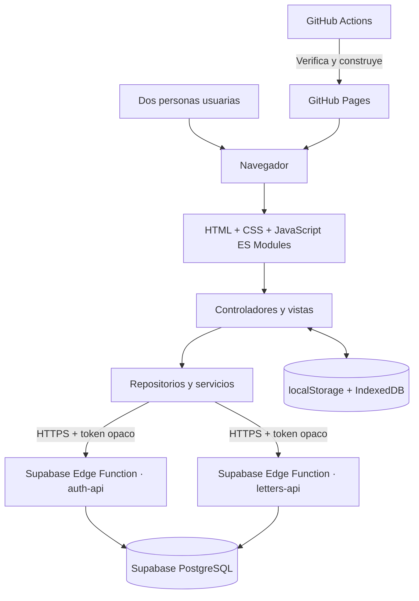

<div align="center">
  
  <br>
  <p><strong>Un espacio privado para que dos personas puedan escribirse, responderse y conservar sus palabras.</strong></p>
  <p>
    <a href="https://deividd11.github.io/Nuestro-rincon/">Abrir aplicación</a>
    ·
    <a href="docs/SECURITY.md">Seguridad y privacidad</a>
    ·
    <a href="docs/ACCESSIBILITY.md">Accesibilidad</a>
    ·
    <a href="docs/SYNC_RELEASE_RUNBOOK.md">Guía de publicación</a>
  </p>
</div>

<div align="center">
  <a href="https://github.com/DeividD11/Nuestro-rincon/actions/workflows/pages.yml"></a>
  
  
  
  
  
  
  <a href="LICENSE"></a>
</div>

---

## ¿Qué es Nuestro Rincón?

**Nuestro Rincón** es una aplicación web de correspondencia privada diseñada para un máximo de dos cuentas. Su propósito es ofrecer un lugar íntimo y sencillo donde escribir cartas, compartirlas con la otra persona, responderlas y conservar la historia de cada conversación.

No es una plataforma pública de mensajería ni una red social. El registro está restringido mediante invitaciones privadas y las operaciones sobre cartas se autorizan en el backend. La interfaz se sirve como un sitio estático desde **GitHub Pages**, mientras que **Supabase** proporciona las funciones de servidor y la persistencia de datos.

El proyecto está construido con HTML, CSS y JavaScript moderno mediante módulos nativos. No necesita un servidor Node.js permanente ni un framework frontend para funcionar en producción.

### ✨ Principios del proyecto

| Principio | Cómo se aplica |
|---|---|
| Privacidad entre dos personas | Registro limitado, invitaciones privadas y autorización en las Edge Functions. |
| Correspondencia con continuidad | Cartas, respuestas, conversaciones y borradores se administran como entidades relacionadas. |
| Conservación del contenido | Copias de emergencia locales y sincronización remota de borradores. |
| Seguridad verificable | Sesiones propias, validación en backend, RLS, límites de solicitudes y pruebas automatizadas. |
| Accesibilidad | HTML semántico, foco visible, teclado, anuncios accesibles y pruebas axe-core. |
| Distribución sencilla | Frontend estático, GitHub Pages y ZIP fuente sin `.git/`, dependencias instaladas ni artefactos locales. |

> [!IMPORTANT]
> **Aviso sobre el backend existente:** el último inventario remoto documentado corresponde al 21 de noviembre de 2026. En esa lectura había 23 migraciones en el historial y las funciones `auth-api` v11 y `letters-api` v8 activas. El paquete local incluye un conjunto de cambios SQL y Edge Functions posterior que todavía requiere reconciliación y validación aislada. No ejecutes `supabase db push`, `migration repair` ni despliegues de funciones en producción basándote únicamente en este ZIP. Sigue primero [`docs/SYNC_RELEASE_RUNBOOK.md`](docs/SYNC_RELEASE_RUNBOOK.md), [`docs/REMOTE_BASELINE.md`](docs/REMOTE_BASELINE.md) y [`docs/DB_REBUILD.md`](docs/DB_REBUILD.md).

---

## Índice

<details>
  <summary><strong>Índice de esta documentación</strong></summary>

  - [Qué es Nuestro Rincón](#qué-es-nuestro-rincón)
  - [Funcionalidades](#funcionalidades)
  - [Experiencia visual y accesibilidad](#experiencia-visual-y-accesibilidad)
  - [Tecnologías](#tecnologías)
  - [Arquitectura](#arquitectura)
  - [Estructura del proyecto](#estructura-del-proyecto)
  - [Requisitos](#requisitos)
  - [Instalación y ejecución local](#instalación-y-ejecución-local)
  - [Configuración de Supabase](#configuración-de-supabase)
  - [Despliegue en GitHub Pages](#despliegue-en-github-pages)
  - [Seguridad y privacidad](#seguridad-y-privacidad)
  - [Notificaciones, sincronización y respaldos](#notificaciones-sincronización-y-respaldos)
  - [Pruebas y calidad](#pruebas-y-calidad)
  - [Distribución del código fuente](#distribución-del-código-fuente)
  - [Estado y limitaciones conocidas](#estado-y-limitaciones-conocidas)
  - [Solución de problemas](#solución-de-problemas)
  - [Documentación técnica](#documentación-técnica)
  - [Licencia](#licencia)

</details>

## Funcionalidades

### Cartas y conversaciones

- **Redacción de cartas:** editor de contenido enriquecido con título y cuerpo.
- **Envío y recepción:** correspondencia privada entre las dos cuentas del espacio.
- **Respuestas:** cada respuesta conserva su relación con la carta original y su conversación.
- **Lectura y navegación:** acceso a cartas y respuestas del mismo hilo sin reconstruir toda la interfaz ni repetir innecesariamente la carga del contenido ya consultado.
- **Organización personal:** bandeja de entrada, enviados, borradores, favoritos, archivo y Papelera.
- **Acciones por participante:** marcar como favorito, archivar o descartar una carta afecta a la organización de la persona que realiza la acción; no modifica por accidente las carpetas de la otra.
- **Eliminación compartida:** la purga de una carta enviada respeta las confirmaciones de los participantes y las reglas del backend.
- **Exportación:** descarga de cartas en texto o HTML UTF-8 e impresión desde el navegador.
- **Búsqueda y navegación progresiva:** consultas paginadas por cursor, orden estable y búsqueda literal en el backend.

### Borradores y continuidad de escritura

- Guardado automático local y remoto.
- Copia de emergencia en el navegador mediante `localStorage` e IndexedDB.
- Cola de sincronización para serializar escrituras y evitar que revisiones simultáneas se pisen.
- Recuperación de contenido pendiente al volver a abrir la aplicación o restablecer la conexión.
- Detección de conflictos entre el contenido local y remoto.
- No se crea un borrador vacío al entrar al editor ni por completar solamente el título.
- Una operación de autoguardado atrasada no debe resucitar un borrador que ya está en Papelera.

La copia local complementa la persistencia remota; no garantiza que una solicitud de red pendiente se complete al cerrar el navegador. La aplicación conserva una copia de emergencia para reducir el riesgo de pérdida de texto.

### Cuentas, invitaciones y sesiones

- Registro con nombre de usuario y contraseña; no exige un correo electrónico.
- Límite de **dos cuentas activas**.
- Invitaciones privadas aleatorias de 256 bits, de un solo uso y con caducidad de siete días.
- La primera cuenta activa puede generar y revocar la invitación de la segunda persona desde Configuración.
- Inicio y cierre de sesión mediante autenticación propia.
- Sesiones con tokens opacos, renovación y revocación.
- Gestión de dispositivos/sesiones activas.
- Cambio de contraseña y actualización de perfil.
- Diez códigos de recuperación de un solo uso por cuenta; la base de datos conserva sus hashes, no los códigos en claro.
- Rotación de códigos de recuperación después de verificar la contraseña actual.
- Eliminación de cuenta con verificación de contraseña y confirmación explícita.

**El correo es informativo.** No se utiliza como identificador de inicio de sesión y no hay recuperación de contraseña por correo electrónico.

### Notificaciones y preferencias

- Centro de notificaciones dentro de la aplicación.
- Preferencias de avisos y tema asociadas a la cuenta.
- Temas claro, oscuro y automático según el sistema.
- Actualización periódica adaptativa según actividad y visibilidad de la pestaña.
- Código de Web Push preparado en frontend y backend, con payload genérico sin títulos ni contenido privado. Su activación en Supabase sigue pendiente de desplegar el conjunto compatible de migración, funciones y secretos VAPID en un entorno aislado.

---

## Experiencia visual y accesibilidad

La interfaz utiliza una dirección visual cálida y editorial: superficies suaves, tonos tierra, tipografía serif para encabezados, paneles discretos y componentes coherentes entre las distintas secciones.

- Diseño responsive para móvil, tableta y escritorio.
- Menú lateral adaptable y navegación por secciones.
- Estados visuales para carga, error, vacío, selección y confirmación.
- Diálogos con gestión del foco y navegación por teclado.
- Regiones accesibles para anuncios de estado y alertas.
- Foco visible y reglas de contraste para los temas claro y oscuro.
- Respeto por `prefers-reduced-motion` para reducir movimiento no esencial.
- Ajustes de áreas seguras y comportamiento de desplazamiento para dispositivos móviles.

### Alcance real de la auditoría

La automatización usa axe-core y reglas WCAG 2.0, 2.1 y 2.2 A/AA en **nueve vistas y dos temas**, con escenarios de error en formularios, códigos de recuperación, Papelera y confirmación de eliminación de cuenta. También comprueba teclado, estados seleccionados/deshabilitados, anchos reducidos y el reflow equivalente a zoom del 200 %.

La auditoría de contraste analiza **24 combinaciones** de la paleta seleccionada. Esto no debe interpretarse como una certificación global de conformidad. Las pruebas manuales con **NVDA + Firefox, VoiceOver + Safari y TalkBack + Chrome** siguen pendientes y deben registrarse conforme a [`docs/ACCESSIBILITY.md`](docs/ACCESSIBILITY.md).

---

## Tecnologías

| Capa | Herramienta | Uso |
|---|---|---|
| Estructura web | HTML5 | Documentos semánticos, formularios y puntos de entrada. |
| Estilos | CSS moderno | Diseño responsive, componentes, temas y estados de interfaz. |
| Lógica cliente | JavaScript ES Modules | Estado, navegación, validación y coordinación de acciones. |
| Servidor | Supabase Edge Functions | Autenticación propia y operaciones privadas de correspondencia. |
| Base de datos | Supabase PostgreSQL | Cuentas, sesiones, cartas, preferencias y notificaciones. |
| Permisos de datos | PostgreSQL RLS y funciones SQL | Restricciones de acceso y operaciones transaccionales. |
| Persistencia local | localStorage e IndexedDB | Recuperación de borradores y continuidad de escritura. |
| Hosting | GitHub Pages | Publicación del frontend estático. |
| Automatización | GitHub Actions | Verificación, auditorías, artefactos y despliegue. |
| Pruebas | Node.js Test Runner, Playwright y axe-core | Contratos, regresiones, responsive y accesibilidad. |
| Edge runtime | Deno | Comprobación de tipos y pruebas unitarias compartidas. |

No se usa React, Vue, Angular ni un framework de frontend. Tampoco existe un servidor Node.js en producción: Node y npm se utilizan para desarrollo, verificación, empaquetado y pruebas.

---

## Arquitectura



### Flujo de una operación privada

1. La vista comunica la intención al controlador correspondiente.
2. El controlador utiliza el repositorio o servicio de dominio.
3. El cliente envía la solicitud HTTPS a la Edge Function e incluye el token opaco de la sesión.
4. La función verifica el token, obtiene la identidad a partir de la sesión almacenada y comprueba los permisos de la operación.
5. El backend consulta o modifica PostgreSQL mediante las funciones y credenciales de servidor correspondientes.
6. La respuesta vuelve al controlador, que actualiza el estado y vuelve a renderizar la sección necesaria.

El backend **no considera fiable un `user_id` enviado por el navegador como prueba de identidad**. La identidad se determina a partir de la sesión validada por el servidor.

### Separación de responsabilidades

| Módulo | Ruta | Responsabilidad |
|---|---|---|
| Configuración | `assets/js/config/` | URL pública de Supabase, clave publishable, nombres de funciones y preferencias regionales. |
| Modelos | `assets/js/models/` | Estado compartido y representación de datos. |
| Vistas | `assets/js/views/` | Renderizado de autenticación, correspondencia y configuración. |
| Controladores | `assets/js/controllers/` | Arranque, eventos, navegación, cuentas, cartas, borradores y preferencias. |
| Repositorios | `assets/js/repositories/` | Acceso al dominio desde la interfaz. |
| Servicios | `assets/js/services/` | Cliente API, sesiones, sincronización y persistencia local. |
| Utilidades | `assets/js/utils/` | DOM seguro, diálogos, formato y funciones compartidas. |
| Funciones compartidas | `supabase/functions/_shared/` | Validación de sesión, solicitudes, cabeceras y utilidades del backend. |
| Edge Functions | `supabase/functions/auth-api/` y `letters-api/` | Endpoints de autenticación y correspondencia. |
| Migraciones y pruebas SQL | `supabase/migrations/` y `supabase/tests/` | Evolución propuesta del esquema y suites pgTAP. |

---

## Estructura del proyecto

```text
nuestro-rincon/
├── .github/
│   └── workflows/                 # Pages, seguridad, pruebas aisladas y respaldos
├── assets/
│   ├── branding/                  # Banner animado de este README
│   ├── css/                       # Estilos por base, componentes y secciones
│   ├── icons/                     # Identidad visual e iconos
│   └── js/
│       ├── config/                 # Configuración pública
│       ├── controllers/            # Controladores y handlers
│       ├── models/                 # Estado de aplicación
│       ├── repositories/           # Repositorios de dominio
│       ├── services/               # API, sesiones y persistencia
│       ├── utils/                  # DOM y utilidades compartidas
│       ├── views/                  # Vistas de cada sección
│       ├── app.js                  # Punto de entrada
│       └── theme-boot.js           # Aplicación temprana del tema
├── docs/                           # Documentación técnica y runbooks
├── scripts/                        # Build, servidor local, backups y ZIP
├── supabase/
│   ├── diagnostics/                # Consultas de reconciliación de solo lectura
│   ├── functions/                  # Edge Functions Deno
│   ├── migrations/                 # Historial y propuestas SQL locales
│   ├── performance/                # Benchmark de búsqueda e índices candidatos
│   ├── schema/                     # Instrucciones para exportar el esquema real
│   └── tests/                      # Siete suites pgTAP
├── tests/
│   ├── e2e/                        # Playwright: accesibilidad y flujos de navegador
│   ├── helpers/                    # Utilidades compartidas para tests
│   └── integration/                # Escenarios HTTP de dos cuentas
├── tools/                          # Verificación, cobertura e informes
├── 404.html                        # Fallback de GitHub Pages
├── index.html                      # Entrada de la aplicación
├── manifest.webmanifest            # Metadatos de instalación
├── service-worker.js                # Recepción de Web Push y clic en notificaciones
├── package.json                    # Scripts y versiones exactas
├── package-lock.json               # Lockfile reproducible
├── .nvmrc                           # Node 24.22.3
├── .nojekyll                        # Publicación directa de recursos
├── .gitignore                       # Exclusión de ficheros locales y secretos
├── LICENSE
└── README.md
```

La salida `_site/` se genera durante el build. No se versiona ni se incluye en el ZIP fuente. Los directorios `.git/`, `node_modules/`, resultados de pruebas, copias de seguridad y archivos de secretos tampoco forman parte de la distribución.

---

## Requisitos

| Herramienta | Versión fijada | Para qué se necesita |
|---|---:|---|
| Node.js | `24.22.3` | Scripts, verificación y pruebas Node. |
| npm | `11.19.1` | Instalar las dependencias exactas de desarrollo. |
| Deno | `2.9.8` | Comprobar y probar las Edge Functions en CI. |
| Supabase CLI | `3.0.0` en workflows que lo utilizan | Operaciones de esquema y respaldo. |
| PostgreSQL `psql` | Cliente compatible | Ejecutar suites pgTAP contra un proyecto aislado. |
| Chromium | Versión gestionada por Playwright | Pruebas de navegador y axe-core. |

En producción, el navegador descarga los archivos estáticos y se comunica con Supabase. Las dependencias npm solo son necesarias para desarrollo y verificación.

---

## Instalación y ejecución local

### 1. Clonar el repositorio

```bash
git clone https://github.com/DeividD11/Nuestro-rincon.git
cd Nuestro-rincon
```

### 2. Instalar las dependencias fijadas

Usa Node.js `24.22.3` y npm `11.19.1`, de acuerdo con `.nvmrc` y `package.json`:

```bash
npm install --global npm@11.19.1
npm ci
```

`npm ci` utiliza `package-lock.json` y falla si `package.json` y el lockfile no representan el mismo árbol de dependencias.

### 3. Ejecutar verificaciones básicas

```bash
npm run check
npm run check:contrast
npm test
```

### 4. Generar el sitio estático

```bash
npm run build:pages
```

El resultado se crea en `_site/`. Para servirlo localmente:

```bash
python -m http.server 8000 --directory _site
```

En Windows también puedes usar:

```powershell
py -m http.server 8000 --directory _site
```

Abre `http://localhost:8000/` en el navegador. Este servidor solo sirve archivos estáticos; no reemplaza las Edge Functions ni PostgreSQL.

### 5. Ejecutar la auditoría de navegador

```bash
npx playwright install chromium
npm run test:a11y
```

Para toda la suite Playwright:

```bash
npm run test:e2e
```

Los escenarios de inicio de sesión remoto necesitan credenciales de dos cuentas de prueba y la configuración `NR_E2E_*` de un proyecto aislado. Las pruebas no deben apuntarse a producción.

---

## Configuración de Supabase

### Configuración pública del frontend

El cliente se configura desde:

```text
assets/js/config/app-config.js
```

Este archivo contiene el nombre de la aplicación, la URL pública del proyecto, la clave `publishable`, los nombres de las Edge Functions, las claves de almacenamiento del navegador y la configuración regional.

La clave `sb_publishable_...` está diseñada para utilizarse desde el navegador y **no es una credencial administrativa**. No coloques `service_role`, `sb_secret_...`, `SUPABASE_SECRET_KEYS`, contraseñas, tokens privados ni claves VAPID privadas en HTML, CSS, JavaScript, archivos públicos o el repositorio.

GitHub Pages no ejecuta `.env` ni variables de servidor. Si cambias de proyecto, actualiza la configuración pública y prepara por separado el backend y el esquema compatibles.

### Funciones incluidas

| Edge Function | Operaciones principales |
|---|---|
| `auth-api` | Registro, login, renovación y cierre de sesión, recuperación, invitaciones y gestión de cuentas. |
| `letters-api` | Cartas, respuestas, borradores, carpetas, preferencias, cuotas y operaciones de notificaciones. |

El archivo `supabase/config.toml` utiliza `verify_jwt = false` para estas funciones porque la aplicación no usa los JWT de Supabase Auth. No significa que los endpoints privados sean anónimos: las funciones verifican el token opaco propio antes de permitir operaciones privadas.

### Historial y cambios SQL: precaución obligatoria

El proyecto Supabase documentado está identificado por `tiqbmuubpbmxqvtkcdhq`. La última lectura remota recogida en la documentación reportó 23 migraciones en el ledger y funciones activas `auth-api` v11 / `letters-api` v8. El inventario local de este paquete incluye 25 archivos SQL: 15 timestamps que coinciden con el historial remoto observado, tres archivos legacy/no canónicos y siete propuestas locales sin entrada homónima en ese ledger. Ocho entradas remotas no tienen archivo local homónimo.

Estas cifras describen el inventario documentado; no son una instrucción para aplicar SQL ni garantizan que el esquema y el ledger sean equivalentes. Parte de los objetos de propuestas anteriores ya se observó en el esquema remoto, pero la lectura no certificó la equivalencia completa de cada definición, permiso, trigger e índice.

**No ejecutes ninguna de las siete propuestas locales sin un diff completo** de funciones, tablas, restricciones, triggers, índices, grants y RLS en un entorno aislado. No elimines ni renumeres los archivos legacy para hacer coincidir timestamps. No uses este paquete como restauración integral de una base nueva.

Antes de cambiar Supabase:

1. Obtén una copia de seguridad restaurable y pruébala en un proyecto aislado.
2. Ejecuta `npm run supabase:reconcile:readonly` con la conexión de solo lectura preparada.
3. Revisa [`docs/REMOTE_BASELINE.md`](docs/REMOTE_BASELINE.md), [`docs/DB_REBUILD.md`](docs/DB_REBUILD.md) y [`docs/SYNC_RELEASE_RUNBOOK.md`](docs/SYNC_RELEASE_RUNBOOK.md).
4. Aplica y prueba las migraciones y Edge Functions en un entorno aislado como un conjunto compatible.
5. Repite pgTAP y las pruebas de dos cuentas antes de aprobar cualquier publicación.

---

## Despliegue en GitHub Pages

El repositorio incluye `.github/workflows/pages.yml`, que valida el código y publica el artefacto estático generado. GitHub Pages no necesita ejecutar Node en producción.

### Configuración inicial

1. Abre el repositorio en GitHub.
2. Ve a **Settings → Pages**.
3. En **Build and deployment**, selecciona **GitHub Actions**.
4. Verifica que el repositorio permita ejecutar Actions y desplegar Pages.
5. Envía los cambios a `main` o inicia `Verify and deploy Nuestro Rincón` desde la pestaña **Actions**.

### Pipeline de publicación

El workflow tiene dos trabajos:

**`verify` — verificación previa**

1. Descarga el repositorio.
2. Prepara Node.js 24.22.3, npm 11.19.1 y Deno 2.9.8.
3. Ejecuta `npm ci` con el lockfile.
4. Ejecuta `npm run check` y `npm run check:contrast` (24 combinaciones de contraste).
5. Ejecuta `npm run check:edge` y `npm run test:edge-unit`.
6. Ejecuta `npm test` y `npm run test:coverage`.
7. Ejecuta `npm run build:pages` y `npm run test:a11y` en Chromium.
8. Publica los artefactos verificados del sitio y del informe de cobertura.

**`deploy` — publicación**

Se ejecuta únicamente después de que `verify` termine correctamente y solo para cambios aceptados en `main`. Descarga el mismo artefacto estático verificado y lo publica mediante GitHub Pages. Las pull requests ejecutan la verificación, pero no despliegan la web.

Las acciones externas de los workflows están fijadas a SHA completos. Dependabot está configurado para proponer actualizaciones.

### Dirección publicada

[https://deividd11.github.io/Nuestro-rincon/](https://deividd11.github.io/Nuestro-rincon/)

> [!NOTE]
> El ruleset de protección de `main` no se activa desde el ZIP ni desde el workflow. Debe configurarlo manualmente una persona administradora en **Settings → Rules → Rulesets**. La guía [`docs/GITHUB_BRANCH_PROTECTION.md`](docs/GITHUB_BRANCH_PROTECTION.md) describe el check que se debe exigir y las restricciones recomendadas.

---

## Seguridad y privacidad

La seguridad se aplica principalmente en el backend. El frontend presenta la interfaz y envía solicitudes, pero no decide por sí solo a qué identidad pertenecen.

### Modelo de autenticación propio

- No se utiliza Supabase Auth.
- El navegador recibe tokens aleatorios opacos para su sesión.
- El backend calcula/verifica los hashes de los tokens y sus fechas de expiración.
- Los refresh tokens se rotan y se controla su reutilización.
- La identidad se obtiene de la sesión validada; no se acepta un `user_id` arbitrario como autorización.
- La credencial de servidor permanece en el runtime de las Edge Functions.

### Controles incluidos en el código

- Derivación de contraseñas PBKDF2-HMAC-SHA256 mediante Web Crypto, con sal individual y parámetros documentados.
- Sesiones propias con expiración, rotación y revocación.
- Invitaciones privadas de un solo uso y límites de intentos.
- Códigos de recuperación aleatorios; PostgreSQL almacena hashes.
- Validación de participantes y pertenencia a conversaciones.
- RLS habilitado y permisos directos restringidos en las tablas privadas.
- Sanitización del HTML enriquecido antes de mostrarlo o exportarlo.
- Validación del tipo y tamaño de las solicitudes a las Edge Functions.
- Límites temporales y cuotas para las operaciones API.
- Content Security Policy en el documento principal y cabeceras de protección del backend.
- Notificaciones Web Push genéricas: no incluyen el título, el remitente ni el cuerpo de una carta.

### Límites que deben comprenderse

> [!WARNING]
> **E2EE todavía no está implementado.** No existe cifrado de extremo a extremo activo: las cartas se procesan en texto legible en las Edge Functions y PostgreSQL. [`docs/E2EE_ARCHITECTURE.md`](docs/E2EE_ARCHITECTURE.md) describe una propuesta futura; no es una función activa.

Otras limitaciones importantes:

- La aplicación admite un máximo de dos cuentas activas.
- El correo electrónico no permite iniciar sesión ni restablecer la contraseña.
- Si se pierden todos los códigos de recuperación y no queda una sesión activa, no existe recuperación alternativa por correo.
- La aplicación no incorpora CAPTCHA ni segundo factor/MFA.
- Un XSS persistente podría comprometer información disponible en el navegador; la CSP y la sanitización reducen riesgos, pero no reemplazan una auditoría de seguridad.
- No se declara una prueba de penetración externa ni una auditoría dinámica exhaustiva.
- El paquete incluye pruebas para entornos aislados; no implica que pgTAP, integración remota o Playwright contra dos cuentas se hayan ejecutado en producción.

Antes de operar invitaciones, códigos o sesiones, revisa [`docs/SECURITY.md`](docs/SECURITY.md), [`docs/INVITATIONS.md`](docs/INVITATIONS.md) y [`docs/ACCOUNT_RECOVERY.md`](docs/ACCOUNT_RECOVERY.md). Nunca compartas invitaciones, códigos de recuperación, tokens ni credenciales de servidor en issues, capturas públicas o documentación.

---

## Notificaciones, sincronización y respaldos

### Actualización dentro de la aplicación

Las notificaciones internas y otros datos que requieren refresco utilizan `AdaptivePoller`, que ajusta la frecuencia a la actividad y visibilidad de la pestaña. No se habilitan canales públicos de Supabase Realtime para evitar exponer datos privados con la arquitectura de sesión opaca actual. La decisión y el trabajo futuro para Realtime privado se describen en [`docs/REALTIME_AUTH_BRIDGE.md`](docs/REALTIME_AUTH_BRIDGE.md).

### Web Push

Web Push tiene service worker, consentimiento por dispositivo y rutas de backend para registrar/revocar suscripciones y enviar avisos genéricos; no se activa hasta aplicar la migración nueva, desplegar `letters-api` y configurar los secretos VAPID en el runtime. **Web Push todavía no está activado en el proyecto Supabase descrito**: falta validar el conjunto compatible de migración, funciones y secretos `VAPID_PUBLIC_KEY`, `VAPID_PRIVATE_KEY` y `VAPID_SUBJECT` en un entorno aislado. No se debe habilitar sin pruebas aisladas en los navegadores y dispositivos objetivo.

Consulta [`docs/PUSH_NOTIFICATIONS_ROADMAP.md`](docs/PUSH_NOTIFICATIONS_ROADMAP.md).

### Copias de seguridad

El repositorio incluye scripts y workflows para exportar, cifrar y restaurar copias en un entorno aislado. La automatización necesita configurar el entorno de GitHub, una identidad `age`, un bucket privado compatible con S3 y los secretos indicados en [`docs/BACKUP_RESTORE.md`](docs/BACKUP_RESTORE.md).

La presencia del workflow no demuestra que el respaldo esté activo ni que una restauración haya sido probada. Antes de considerar recuperable una copia, realiza una restauración controlada y valida el esquema y los datos en una base desechable.

---

## Pruebas y calidad

### Comandos disponibles

| Comando | Qué comprueba | Requisitos / observaciones |
|---|---|---|
| `npm run check` | Estructura, archivos requeridos, sintaxis, imports, rutas locales y configuración. | Node.js. |
| `npm test` | Suite unitaria, contratos, seguridad, regresiones y documentación. | Node.js; no requiere un backend remoto. |
| `npm run check:contrast` | 24 combinaciones seleccionadas de la paleta clara y oscura. | Node.js. |
| `npm run test:coverage` | Cobertura de módulos JS del frontend y umbrales de líneas, funciones y ramas. | Node.js. Genera `coverage/lcov.info`. |
| `npm run build:pages` | Crea el sitio estático en `_site/`. | Node.js. |
| `npm run check:edge` | Type-check de `auth-api`, `letters-api` y los módulos compartidos importados. | Deno 2.9.8. |
| `npm run test:edge-unit` | Pruebas unitarias del parser y lógica compartida de las Edge Functions. | Deno 2.9.8. |
| `npm run test:a11y` | axe-core en nueve vistas, dos temas y escenarios adicionales de accesibilidad. | `npm ci` y Chromium instalado por Playwright. |
| `npm run test:e2e` | Flujos Playwright en escritorio y móvil. | Los casos de login remoto requieren dos cuentas de prueba en un proyecto aislado. |
| `npm run test:integration` | Escenarios HTTP reales de aislamiento entre dos cuentas, sesiones y acciones de correspondencia. | Proyecto Supabase aislado y credenciales de prueba. |
| `npm run test:db` | Siete suites pgTAP con aserciones SQL. | `psql`, pgTAP y una base Supabase aislada; producción queda bloqueada por el ejecutor. |
| `npm run package:zip` | Crea una distribución fuente depurada. | Escribe por defecto `dist/nuestro-rincon-source.zip`. |
| `npm run supabase:reconcile:readonly` | Informe de diferencias de metadatos entre el código y el Supabase conectado. | Acceso PostgreSQL de solo lectura y configuración correcta del destino. |

### Suites pgTAP incluidas

`npm run test:db` ejecuta estos **siete archivos pgTAP**:

1. `auth_rate_limits.test.sql`
2. `shared_letter_purge.test.sql`
3. `profile_rename_transaction.test.sql`
4. `recovery_code_bundles.test.sql`
5. `cursor_pagination.test.sql`
6. `api_rate_limits_and_push.test.sql`
7. `search_semantics.test.sql`

El ejecutor requiere `NR_TEST_CONFIRM_ISOLATED=YES`, `NR_DB_TEST_PROJECT_REF` y `NR_TEST_DATABASE_URL`. Rechaza la referencia del proyecto de producción y comprueba que la URL PostgreSQL corresponda al proyecto de pruebas. No omitas estas protecciones.

### Flujos de integración aislados

Los workflows manuales `security-db.yml`, `security-integration.yml` y `security-playwright.yml` requieren credenciales de una branch/proyecto Supabase desechable. Pueden crear cuentas, consumir invitaciones, crear cartas y eliminar datos de prueba. No configures nunca esos secretos con cuentas o conexiones de producción.

### CI de GitHub Pages

El workflow de publicación ejecuta estructura, contraste, comprobación Deno, pruebas Node, cobertura, build estático y axe-core. Los workflows de PostgreSQL, integración real de dos cuentas y Playwright autenticado son manuales porque requieren recursos y credenciales de un entorno aislado. Consulta [`docs/CI_RELEASE_POLICY.md`](docs/CI_RELEASE_POLICY.md) y [`docs/SECURITY_TESTING.md`](docs/SECURITY_TESTING.md).

---

## Distribución del código fuente

Para construir un ZIP fuente desde el repositorio:

```bash
npm run package:zip
```

Por defecto se genera:

```text
dist/nuestro-rincon-source.zip
```

También puedes indicar una ruta distinta:

```bash
npm run package:zip -- --output /ruta/al/paquete.zip
```

El empaquetador conserva la aplicación, los scripts, las migraciones, las pruebas, la documentación y los workflows. Excluye expresamente:

- `.git/` y archivos marcadores `.git` de worktrees.
- `node_modules/` y cachés.
- `_site/`, `dist/` y otras salidas de compilación.
- Cobertura, reportes de Playwright y resultados de prueba.
- `.env` y otros archivos de entorno privados.
- Backups, archivos `.age`, dumps y paquetes de datos.
- Archivos temporales del sistema y ZIP anteriores.

No elimina `.github/` ni `.gitignore`: son archivos distintos de `.git/` y son necesarios para mantener la automatización y las reglas del repositorio.

---

## Estado y limitaciones conocidas

| Área | Estado descrito en este paquete |
|---|---|
| Frontend estático | Incluido; preparado para GitHub Pages. |
| Autenticación personalizada | Implementada en el código; no utiliza Supabase Auth. |
| Correspondencia y borradores | Implementados en frontend y Edge Functions incluidas. |
| Paginación por cursor | Implementada en el código local; revisar compatibilidad remota antes de desplegar. |
| Búsqueda | Búsqueda literal en el backend; índices trigram candidatos documentados, no aplicados por este paquete. |
| Accesibilidad automática | axe-core, contraste, estados y geometría incluidos en las pruebas. |
| Lectores de pantalla | Validación manual pendiente con NVDA, VoiceOver y TalkBack. |
| Web Push | Código preparado; activación remota pendiente de migración, funciones y secretos compatibles. |
| Supabase Realtime privado | No habilitado; se usa sondeo adaptativo. |
| Cifrado E2EE | No implementado; solo existe documento de arquitectura propuesta. |
| Backups externos | Scripts/workflow incluidos; requieren configuración y una restauración verificada. |
| Protección de `main` | Instrucciones incluidas; debe activarse manualmente desde GitHub. |
| Reconciliación del backend | Pendiente de revisar el ledger, el esquema y las funciones antes de publicar cambios SQL/Edge. |

Estas distinciones son deliberadas: tener código, migraciones o workflows en el repositorio no significa que la capacidad esté activa en el proyecto remoto.

---

## Solución de problemas

| Problema | Qué revisar |
|---|---|
| GitHub Pages no publica | Comprueba **Settings → Pages**, permisos de Actions y el último run de `pages.yml`. El job `deploy` solo se ejecuta después de `verify`. |
| La aplicación carga pero no conecta con Supabase | Verifica URL y clave `publishable` en `assets/js/config/app-config.js`, estado de las Edge Functions y consola del navegador. |
| Error de CORS o función no disponible | Confirma la URL de Supabase, nombres de función, respuesta preflight y compatibilidad entre el frontend y la versión desplegada. No abras CORS indiscriminadamente. |
| Borrador no sincronizado | Conserva la copia local, revisa conectividad y estado de sincronización, y resuelve el posible conflicto antes de descartar contenido. |
| No aparece la segunda cuenta | Revisa si la invitación sigue vigente y si la segunda cuenta ya completó el registro. Solo se permiten dos cuentas activas. |
| No es posible recuperar una contraseña | Utiliza uno de los códigos personales de respaldo. No existe recuperación por email. |
| Playwright no encuentra Chromium | Ejecuta `npx playwright install chromium`. |
| pgTAP se niega a iniciar | Comprueba `NR_TEST_CONFIRM_ISOLATED=YES`, que el ref sea distinto de producción y que la URL PostgreSQL coincida con el proyecto aislado. |
| Cambios de Supabase no coinciden con el ZIP | No ejecutes migraciones a ciegas; genera el informe de solo lectura y sigue el runbook de reconciliación. |

---

## Documentación técnica

| Documento | Contenido |
|---|---|
| [`docs/SECURITY.md`](docs/SECURITY.md) | Modelo de confianza, sesiones, permisos, límites de seguridad y privacidad. |
| [`docs/INVITATIONS.md`](docs/INVITATIONS.md) | Creación, entrega, revocación y bootstrap de invitaciones privadas. |
| [`docs/ACCOUNT_RECOVERY.md`](docs/ACCOUNT_RECOVERY.md) | Códigos de respaldo, bóveda local y recuperación de cuentas. |
| [`docs/ACCESSIBILITY.md`](docs/ACCESSIBILITY.md) | Teclado, foco, contraste, axe-core y matriz manual de lectores de pantalla. |
| [`docs/SECURITY_TESTING.md`](docs/SECURITY_TESTING.md) | Pruebas de dos cuentas, pgTAP y Playwright en proyectos aislados. |
| [`docs/CI_RELEASE_POLICY.md`](docs/CI_RELEASE_POLICY.md) | Quality gates, workflows y política de publicación. |
| [`docs/GITHUB_BRANCH_PROTECTION.md`](docs/GITHUB_BRANCH_PROTECTION.md) | Configuración recomendada para proteger `main`. |
| [`docs/REMOTE_BASELINE.md`](docs/REMOTE_BASELINE.md) | Inventario remoto conocido e historial de reconciliación. |
| [`docs/DB_REBUILD.md`](docs/DB_REBUILD.md) | Diferencias entre historial de migraciones y snapshot del esquema. |
| [`docs/SYNC_RELEASE_RUNBOOK.md`](docs/SYNC_RELEASE_RUNBOOK.md) | Procedimiento seguro antes de sincronizar migraciones y Edge Functions. |
| [`docs/PAGINATION.md`](docs/PAGINATION.md) | Contrato de cursor, paginación y recuentos. |
| [`docs/LETTER_SEARCH_PERFORMANCE.md`](docs/LETTER_SEARCH_PERFORMANCE.md) | Rendimiento de búsqueda, EXPLAIN y candidatos `pg_trgm`. |
| [`docs/LETTERS_CONSISTENCY.md`](docs/LETTERS_CONSISTENCY.md) | Carpetas, consistencia de conversaciones y eliminación compartida. |
| [`docs/CONTROLLER_ARCHITECTURE.md`](docs/CONTROLLER_ARCHITECTURE.md) | Modularización de controladores, vistas y actualización adaptativa. |
| [`docs/PUSH_NOTIFICATIONS_ROADMAP.md`](docs/PUSH_NOTIFICATIONS_ROADMAP.md) | Web Push: arquitectura, requisitos y estado de activación. |
| [`docs/REALTIME_AUTH_BRIDGE.md`](docs/REALTIME_AUTH_BRIDGE.md) | Requisitos para habilitar Realtime privado con autenticación propia. |
| [`docs/E2EE_ARCHITECTURE.md`](docs/E2EE_ARCHITECTURE.md) | Propuesta de diseño para cifrado de extremo a extremo. |
| [`docs/BACKUP_RESTORE.md`](docs/BACKUP_RESTORE.md) | Exportación, cifrado y restauración de respaldos. |

---

## Licencia

El proyecto se distribuye con **Todos los derechos reservados**. Que el repositorio sea visible públicamente no concede permiso general para copiar, modificar, redistribuir, publicar obras derivadas o explotar comercialmente el código y el diseño. Consulta [`LICENSE`](LICENSE) y solicita autorización expresa al titular para cualquier uso adicional.

---

<div align="center">
  <sub>Hecho para que las palabras importantes tengan un lugar al que volver. ✉️</sub>
  <br>
  <sub>© 2026 · Nuestro Rincón</sub>
</div>
